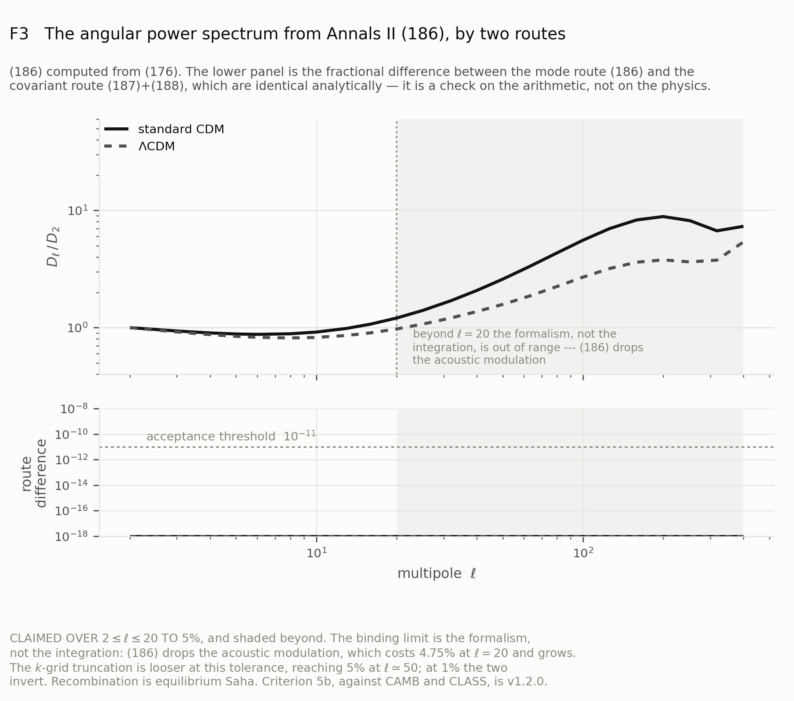
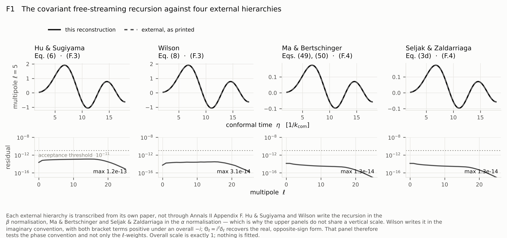

# 1+3 covariant CMB anisotropies reproducibility bundle

Version: **v1.4.0-dev** — the radiation era on the frame-invariant line of
sight: the radiation-era potential, the driving it gives the acoustic
oscillator (approximation A-3) and the tight-coupling transition (A-5). The
supplement registers the test of this work before the work begins.
**Last release: v1.3.0** — 4 November 2026: the line-of-sight integral
assembled from Paper 1's linear redshift source as a Sachs–Wolfe, a Doppler
and an integrated slot, each invariant under a change of frame. The two frames
give one $C_\ell$ to $4\times10^{-14}$ (D44), the slots sum back to the
integral they rearrange (D45), and F9 and F10 are drawn from them.

Supplement: **v1.4.6** — `SUPPLEMENTARY-MATERIAL-v1.4.6.tex`. The supplement
has its own version line. An edition records the state of the documentation
and does not assert that the computational release above has advanced, so
`scripts/_versions.py` reads the supplement's name from this line and never
from the computational one.

Supplementary code and materials for: Tim Gebbie, *"Frame covariance of CMBR
lensing in the exact $1+3$ covariant radiation hierarchy"* (Paper 1),
University of Cape Town, 2026, arXiv:astro-ph/9912072v4
([doi:10.48550/arXiv.astro-ph/9912072](https://doi.org/10.48550/arXiv.astro-ph/9912072)), submitted 2026-10-16, CC BY 4.0.

> Cite the identifier with its version. `astro-ph/9912072` has carried three
> documents: v1 and v2 (December 1999), the legacy work; v3 (3 October 2026),
> the correction that withdrew the 1999 claim of a new effect; and v4
> (21 October 2026), Paper 1. Cite `v4` for Paper 1, `v3` for the correction
> and `v2` for the legacy work. An unversioned reference now resolves to
> Paper 1.

The supplementary-materials document is included here:

> [SUPPLEMENTARY-MATERIAL-v1.4.6.pdf](supplementary-materials/SUPPLEMENTARY-MATERIAL-v1.4.6.pdf)

Its source, `SUPPLEMENTARY-MATERIAL-v1.4.6.tex`, is one file in the
repository root, and `scripts/build_supplement.py` builds it with `pdflatex`
alone: the prose carries no `\input`, the bibliography is inline, and the only
external files are the generated assets in `tables/`, `tikz/` and `figures/`.
It carries the scope, the theory-to-computation map, the acceptance spine, the
conventions and translations tables and the derivation behind each step of the
chain below; its appendices, after the references, carry the derivations off
that chain and the interpretive limits. Read it before the code to see what
this release does and does not claim.

## Key figure: the formation surface


Figure F10 shows the angular autocorrelation at a sequence of conformal times
and the surface it sweeps: Planck 2018, CDM frame, 25 multipoles from $\ell=2$
to $\ell=300$, fourteen epochs from the start of recombination to today. Panel
(a) is $D_\ell$ against $\ell$ epoch by epoch, normalised once by the maximum
of today's curve, so it shows growth and shape together. Panel (b) is
$C_\ell(\eta)/C_\ell(\eta_0)$ over the plane of $\ell$ and
$(\eta-\eta_\ast)/(\eta_0-\eta_\ast)$. The line of sight is the supplement's
`eq:assembly-invariant` with Paper 1's source signs, each slot accumulated to
each epoch, and the $\eta_0$ column reproduces the full integral to
$1.0\times10^{-13}$. Generated by `scripts/figure_f10_formation_surface.py`
from `functions/spectra/line_of_sight.py`; the accumulation is committed as
`outputs/f10-formation-surface.csv`.

Above $\ell\simeq30$ the spectrum is laid down while photons scatter, and 5 to
21% of each multipole arrives afterwards from the integrated Sachs–Wolfe term
as the potentials decay. At $\ell=2$ to $4$ the late term deposits 54, 37 and
22% of today's $C_\ell$, counting what is laid down after
$(\eta-\eta_\ast)=0.01\thinspace(\eta_0-\eta_\ast)$, when the visibility has closed.
At $\ell=5$ to $12$ the late share is negative, $-3$ to $-51$% of today's
$C_\ell$, with the largest cancellation at $\ell=7$: the late term cancels
part of what recombination laid down. Below $\ell\simeq30$ the potential both
slots read carries an incomplete radiation era (A-3, step 7 below), so these
shares are not yet predictions. F11, v1.4.0's lead figure, is this figure
with the radiation era wired.

Every earlier version of this figure was drawn from the antecedent's
line-of-sight solution (102) and showed no late power at all, on every
background (T-128). (102) carries its integrated term at the visibility
$\mathcal V$ where the exact integration by parts wants the optical-depth weight
$W$ (B-17, discrepancy (i)), and $\mathcal V$ vanishes after recombination.
The assembly that replaced (102) carries that term at $W$ and restores the
late integrated Sachs–Wolfe effect. Einstein–de Sitter, whose potential is
exactly constant, is the null control: there the late share must be zero.

## The angular spectrum


Figure F9 is the angular power spectrum for the three backgrounds this bundle
ships, CDM (Einstein–de Sitter), ΛCDM and the stamped Planck 2018 set, as
shape: $D_\ell$ renormalised at $\ell=30$. The line of sight is the
supplement's `eq:assembly-invariant`, built from the coefficients with Paper
1's source signs: the Sachs–Wolfe and Doppler terms where photons scatter, the
integrated Sachs–Wolfe term along the path, each invariant under a change of
frame, and no coefficient that holds the scattering rate differentiated.
Generated by `scripts/figure_f9_acoustic_spectrum.py` from
`functions/spectra/line_of_sight.py`, and drawn from
`outputs/f9-acoustic-spectrum.csv`.

Panel (a) draws the spectra in the CDM frame. The first maxima are at
$\ell=165.4$ on Einstein–de Sitter, $143.8$ on ΛCDM and $188.5$ on Planck,
which is $0.7067\thinspace\ell_A$, against 206.1 for CAMB and 206.2 for CLASS;
each maximum is the vertex of a parabola through three multipoles 30 apart,
so it carries $\pm15$. The odd acoustic peaks are present and the even ones
absent: the second maxima stand at 496 on Einstein–de Sitter and 443 on ΛCDM,
three times the first, so each is the third peak, where CAMB's maxima are at
206, 492 and 729; on Planck the third maximum, near $\ell\simeq700$, is too
shallow for the shared prominence rule. An undriven, baryon-loaded oscillator
predicts this: with no radiation-era driving the zero point of the
oscillation is set by the baryon loading, and an even peak stands at about
$(1+6R)^{-2}$ of its odd neighbours. The driving that sets the peak heights
is approximation A-3, upstream of the line of sight and v1.4.0's work. Below
$\ell\simeq30$ the Planck curve carries the same incomplete radiation era:
the Sachs–Wolfe source at last scattering is 0.187 against $\Phi/3=0.310$,
the integrated slot, 0.535, enters with the opposite sign, and $D_\ell/D_{30}$
falls to 0.44 for $\ell$ from 4 to 11 where CAMB holds 0.78. The bump at
$\ell\simeq7$ to $12$ is the start rule's (T-192). None of that is a
prediction of v1.3.0.

CAMB and CLASS are drawn as context and not as a target (decision **S4c**). They
share a first peak at $\ell\simeq206$ and agree with each other to 0.3%.
Acceptance criterion 5b is gated on this bundle's own pipeline: (102) against
(177)–(179), agreeing to $9.5\times10^{-6}$ against a gate of $10^{-3}$. The
itemised distance to the external codes, as it stood at v1.2.0, is in
`provenance/CRITERION-5B-v1.md`.

Panel (b) draws the same spectra in both frames. Both come from one solve: the
coefficients are carried with a generic $u^a$ and the frame is chosen at the
end, so the Newtonian and CDM curves are two projections of the same
coefficients rather than two calculations. They coincide to
$3.5\times10^{-14}$ at every multipole. A first-order change of frame moves
only the dipole, and the figure shows it moving nothing at $\ell\ge2$. A
gauge-fixed treatment cannot draw this panel, since it fixes the frame at the
start of the derivation rather than choosing it at the end.

## The physics

We compute the CMB angular power spectrum from the exact $1+3$ covariant
radiation hierarchy, not from a gauge-fixed perturbation theory with a
covariant gloss. The chain below runs from the hierarchy to $C_\ell$, and each
step names the module that implements it.

### Notation

Every symbol in the chain is defined here once. Equation numbers in the tags
are those of *Annals II* as published; the full conventions sheet is
`provenance/conventions.md`.

The wavenumber $k$ is comoving throughout. Appendix F's recursions and the
integral solution (102) are written in the comoving wavenumber, so
$k_{\rm phys}=k/a$, and `functions/harmonics/free_streaming.py` records that
the two differ by a factor $a$ in precisely these equations.

An overdot is the derivative along the fundamental congruence, $u^a\nabla_a$;
a prime is $\mathrm d/\mathrm d\eta$, with $\eta$ conformal time. The transport
equation of step 1 is written in conformal time throughout.

| symbol | meaning |
|---|---|
| $u^a$, $e^a$ | the fundamental 4-velocity; a unit direction on the sky, so $T(x,e)$ is the temperature seen looking along $e^a$ |
| $\eta$, $\eta_0$, $\eta_\ast$ | conformal time; today; last scattering. $\Delta\eta\equiv\eta_0-\eta$ and $\Delta\eta_\ast\equiv\eta_0-\eta_\ast$ |
| $a$, $\mathcal H$ | scale factor; conformal Hubble rate $a'/a$ |
| $k$, $r_s$ | comoving wavenumber; comoving sound horizon at last scattering |
| $\ell_A$ | the acoustic scale $\pi r_\theta/r_s$, with $r_\theta$ the comoving distance to last scattering |
| $\mathrm D_a$ | spatial derivative, projected orthogonal to $u^a$ |
| $\langle\thinspace \cdots\thinspace \rangle$ | the projected, symmetric, trace-free (PSTF) part of the enclosed indices |
| $A_\ell$ | the multi-index $a_1\ldots a_\ell$ |
| $A_a$ | the acceleration $\dot u_a$, a different object from $A_\ell$ that shares a letter |
| $\tau_{A_\ell}$, $\tau_\ell$ | PSTF temperature multipoles; the mode coefficient of the same |
| $T$, $\delta T$ | the temperature, defined as the monopole of $T(x,e)$; its perturbation |
| $T_\ell(k)$ | the transfer function, which carries a multipole index and is not the temperature |
| $O^{A_\ell}$, $\beta_\ell=\ell!/(2\ell-1)!!$ | the PSTF direction tensor; its normalisation $O^{A_\ell}O_{A_\ell}$. $\beta_0=\beta_1=1$, $\beta_2=\tfrac23$ |
| $\alpha_\ell=(2\ell+1)/\beta_\ell$ | the normalisation in which (F.4) takes the Ma & Bertschinger form. $\alpha_0=1$, $\alpha_1=3$, $\alpha_2=\tfrac{15}2$ |
| $\mathcal B_{A_\ell}$, $\mathcal S_{A_\ell}$ | the gravitational source; the in-scattered Thomson source |
| $\sigma_{ab}$, $\sigma_T$ | the shear; the Thomson cross-section, again one letter for two objects |
| $\kappa'=an_e\sigma_T$ | differential optical depth, with $n_e$ the free-electron density |
| $W=e^{-\kappa}$, $\mathcal V=W\kappa'$ | the optical-depth weight; the visibility function, with $W'=\mathcal V$ |
| $\mathcal D$, $k_D$ | the diffusion (Silk) damping factor $e^{-(k/k_D)^2}$ and its scale. $\mathcal D$ is not $\mathrm D_a$ |
| $\Phi_A$, $\Phi_H$ | the acceleration and curvature potentials of the frame $u^a$. Each shifts by $(v'+\mathcal Hv)/k$ under a change of frame; their difference, which sets the electric Weyl tensor, does not |
| $\rho_b$, $\rho_\gamma$, $R=3\rho_b/4\rho_\gamma$ | baryon and photon energy densities; the baryon loading |
| $\hat v_B$, $q_a$ | the baryon velocity; the energy flux, which the CDM frame sets to zero |
| $v^a$, $v_{A_\ell}$ | the frame tilt $\tilde u^a-u^a$; its PSTF part of rank $\ell$, identically zero for $\ell\ge2$ |
| $c_\pm$ | coefficients of $\tau_{\ell\pm1}$ in the $O(\ell)$ aberration coupling. Subscripts $\mathrm N$ and $\mathrm{CDM}$ label the two frames throughout |
| $f_\ell$ | the multipole profile the $O(\ell)$ stencil differentiates, as $\ell\thinspace \partial_\ell f_\ell$ |
| $C_0,C_1,C_2$; $p_0,p_1,p_2$ | the matching coefficients of (89); their exact rational prefactors |
| $C_1^{\rm grav}$, $C_1^{\rm scatt}$ | the gravitational and Thomson halves of $C_1$, with $C_1^{\rm scatt}=-\kappa'\hat v_B$ |
| $K$, $G$ | the kernel $j_\ell(k(\eta_0-\eta))$, a prime on it the derivative in $\eta$; the combination $G\equiv C_1^{\rm grav}-C_2'$ |
| $j_\ell$, $P(k)$, $C_\ell$ | spherical Bessel function; primordial power; the angular power spectrum |

### The chain

#### 1. The hierarchy

The photon distribution is expanded in PSTF temperature
multipoles $\tau_{A_\ell}=\tau_{a_1\ldots a_\ell}$ about a chosen 4-velocity
$u^a$. The exact transport equation is *Annals II*'s Eq. (67), written in
conformal time:

$$\tau_{A_\ell}'+a\left[\tfrac{\ell+1}{2\ell+3}\mathrm D^a\tau_{A_\ell a}+\mathrm D_{\langle a_\ell}\tau_{A_{\ell-1}\rangle}\right]+a\mathcal B_{A_\ell}+\kappa'\tau_{A_\ell}=\kappa'\mathcal S_{A_\ell}\quad(67)$$

The gravitational source stands on the left, as it does in (67). Both
streaming couplings carry a plus sign, since both come from the one operator
$e^a\mathrm D_a$, and only that form reduces to Appendix F's (F.1). `functions/spectra/` carries the equation, and `tests/`
holds the Appendix F chain against four external hierarchies.

#### 2. The source

The gravitational source closes at rank two. It vanishes identically for
$\ell\ge3$, and its three ranks are

$$\mathcal B_0=-\tfrac13\mathrm D^a\tau_a,\qquad \mathcal B_a=\mathrm D_a\ln T+A_a,\qquad \mathcal B_{ab}=\sigma_{ab}\quad(68)$$

a monopole from the dipole divergence, a gradient-plus-acceleration at rank
one, and the shear at rank two. Because the chain terminates, a closed-form
integral solution exists, and the shear entry is why this repository is called
`NonlinearShear`. In the mode coefficients *Annals II* defines after its
Eq. (7), $a\mathcal B_0=-\tfrac k3\tau_1$, $a\mathcal B_1=k(\delta T+\Phi_A)$
and $a\mathcal B_2=a\sigma$. Paper 1's linear redshift source, its Eq. (37), is
the same source written on the right, $\mathcal B^{\rm P1}=-\mathcal B$, and it
stands against the Thomson Doppler term with the opposite sign. The matching's
rank-one row needs that sign: (89) prints $-(a\mathcal B_1+\kappa'v_B)$, the
frame conditions of step 7 select $a\mathcal B_1-\kappa'v_B$, and the two
agree once $a\mathcal B^{\rm P1}_1=-k(\delta T+\Phi_A)$ stands in
$\mathcal B_1$'s place, which is how the code carries it.
`functions/spectra/coefficients.py`.

#### 3. The frame law

Under a change of fundamental congruence
$\tilde u^a=u^a+v^a$, GDE99 (37) gives

$$\tilde\tau_{A_\ell}=\tau_{A_\ell}-v_{A_\ell}, \qquad v_{A_\ell}\equiv0\ \ (\ell\ge2)\quad(GDE99 37)$$

so only the monopole and dipole move. Every multipole with $\ell\ge2$ is a
frame invariant at first order, and not because a boost cannot reach it: those
multipoles are already first-order small, so what a boost generates from them
is second order. Only $\tau_0$ is of order one, which is why the dipole moves
and nothing above it does. The bundle computes the spectrum in the Newtonian
frame, $\tilde\sigma_{ab}\simeq0$, and in the CDM frame, and the two must
agree, so a disagreement is a defect and not physics. F5 and D6 measure that
for (102), and D44 for the assembly of step 7.
`functions/spectra/frame_transform.py`, `functions/frames.py`.

The same $v^a$ also moves the direction basis, which is aberration, and that
action does not stop at $\ell=2$. Aberration couples neighbouring multipoles
with coefficients that grow like $\ell$, and the difference of the two
neighbour weights differs between the frames:

$$c_+-c_-|_{\mathrm N}=\frac{2(2\ell^2+2\ell-1)}{(2\ell-1)(2\ell+3)}\xrightarrow{\ \ell\to\infty\ }1, \qquad c_+-c_-|_{\mathrm{CDM}}=\frac{3(4\ell^4+8\ell^3-11\ell^2-15\ell+6)}{(2\ell-3)(2\ell-1)(2\ell+3)(2\ell+5)}\xrightarrow{\ \ell\to\infty\ }\tfrac34\quad(Paper 1)$$

Both stencils are unit-normalised, $2\times\tfrac12=1$ and $4\times\tfrac14=1$,
so the two frames thread different coefficients onto the same
$\ell\thinspace \partial_\ell f_\ell$, and frame covariance holds at $O(\ell)$,
where the moment law has nothing left to say. The surviving $O(\ell)$ content
is gravitational lensing together with observer aberration, the result Paper 1
is named for; the coefficients are the brackets Paper 1 prints after the
$\beta$ normalisation. This does not say that lensing is a frame effect: one
$v^a$ acts on the moments and on the direction basis, and only the second
action survives at large $\ell$.

#### 4. The acoustic oscillator

Before last scattering photons
and baryons are tightly coupled, and the rank-0 and rank-1 multipoles obey the
acoustic pair (152)/(153),

$$\tau_1'=-\frac{R'}{1+R}\tau_1-\frac{k}{1+R}\delta T-k\Phi_A, \qquad \delta T'=-\mathcal H\Phi_A-\Phi_H'+\tfrac k3\tau_1\quad(152, 153)$$

with $R$ the baryon loading. Its $\cos(kr_s)$ is the acoustic series. Dropping
$-\mathcal H\Phi_A$ is *Annals II*'s small-scale approximation, which turns
the pair into (154), and the released solver integrates the pair with that
term dropped (`expansion_coupling=False` in every released route). Whether the
oscillator should carry $-\mathcal H\Phi_A$ is not yet settled. Each mode
starts where $kr_s=\varepsilon$ (T-51), or at the table's first point when it
never reaches it, on the matter-era adiabatic condition
$\delta T=-\tfrac23\Phi_A$, $\tau_1=0$, and is integrated to six times
$\eta_\ast$, after which its moments are held. On `PLANCK_MODEL` the start rule
gives a band of modes, $2.7<k<5.4$, the matter-era condition on a potential
that has already decayed (T-192); the start and the initial condition are
redefined with the radiation era in v1.4.0. The recombination history is
solved from Peebles' equation, and the grid is derived from the visibility's
own width (**S33**). `functions/spectra/acoustic.py`, `decoupling.py`,
`peebles.py`.

#### 5. Free streaming

After decoupling $\kappa'\to0$, and by step 2 the
gravitational source vanishes for $\ell\ge3$. What is left of step 1 is a
recursion coupling each multipole to its two neighbours, *Annals II*
Appendix F (F.3), in conformal time:

$$-(\beta_\ell\tau_\ell)' =k\left[\frac{\ell+1}{2\ell+3}\thinspace (\beta_{\ell+1}\tau_{\ell+1}) -\frac{\ell}{2\ell-1}\thinspace (\beta_{\ell-1}\tau_{\ell-1})\right]\quad(F.3)$$

The source supplies $\ell=0,1,2$, and every multipole above them is streamed up
by this recursion. Its closed-form solution is $j_\ell(k(\eta_0-\eta))$, which
is why the kernel in step 6 is a spherical Bessel function rather than a
fitted window: the projection is the hierarchy's own solution and not an
approximation imposed on it. Appendix F writes the recursion three ways: (F.1)
in proper time with the comoving wavenumber, (F.3) above, and (F.4) in the
normalisation that makes it the Ma & Bertschinger form. The bundle integrates
all three as printed and privileges none, which is the acceptance spine of
v1.0.0 and what F1 reports: four external hierarchies, two normalisations, two
phase conventions, residuals below $10^{-13}$. (F.4) as printed keeps
$(2\ell+1)$ on the left although its own preceding text specifies the division
(B-2); the bundle divides. `functions/harmonics/free_streaming.py`,
`weights.py`, `external.py`.

#### 6. The matching and the integral solution

At decoupling the free-streaming
solution of step 5 is matched to the source rank by rank, (89), giving three
coefficients:

$$C_0=p_0\thinspace (a\mathcal B_2),\qquad C_1=p_1\thinspace \tfrac1k\negthinspace \left(a\mathcal B_1+\kappa'\hat v_B\right),\qquad C_2=p_2\thinspace \tfrac1{k^2}(a\mathcal B_2)\quad(89)$$

(89) is the definition and (90) its result, so the bundle solves (89) in exact
rationals and uses (90) as a check. Its $\ell=0$ row carries two printing
defects: it gives the entry $j_0''(0)$ as $+\tfrac13$, where the ascending
series gives $-\tfrac13$ (B-11), and the rank-two normalisation
$\alpha_2=\tfrac{15}2$, where $\alpha_0=1$ belongs (B-16). Corrected, the row
gives $C_0=-\tfrac13a\mathcal B_2$ in place of (90)'s $-\tfrac52a\mathcal B_2$.
The coefficients are covariant and gauge-invariant with respect to a generic
$u^a$, so a frame choice sets them. The Newtonian frame is
$\tilde\sigma_{ab}\simeq0$, so that as built $\tilde C_0\simeq\tilde C_2\simeq0$
and $\tilde C_1$ stands alone; the CDM frame is $q_a=0$ and keeps all three.
With Paper 1's source $C_0$ also carries $-a\mathcal B_0=\tfrac k3\tau_1$,
which does not vanish in the Newtonian frame. *Annals II*'s line-of-sight
solution (102) carries the coefficients to the present:

$$\frac{\beta_\ell\thinspace \tau_\ell(\eta_0)}{2\ell+1}\simeq[C_2'-C_1]_{\eta_\ast}\mathcal D\thinspace j_\ell(k\Delta\eta_\ast)+kC_2(\eta_\ast)\mathcal D\left[\tfrac{\ell}{2\ell+1}j_{\ell-1}-\tfrac{\ell+1}{2\ell+1}j_{\ell+1}\right]_{k\Delta\eta_\ast}+\int_{\eta_\ast}^{\eta_0}\mathrm d\eta\thinspace \mathcal V e^{-(k/k_D)^2}\lbrace C_0-C_1'+C_2''\rbrace \thinspace j_\ell(k\Delta\eta)\quad(102)$$

Its second term is the rank-two boundary, the only place in (102) where the
projection couples $\ell$ to $\ell\pm1$, at the boundary rather than along the
path as in step 5. (102) is kept as built for comparison; v1.3.0 releases the
assembly of step 7 in its place. `functions/spectra/coefficients.py`,
`integral_solution.py`.

#### 7. The frame-invariant assembly

A change of frame moves only the dipole (step 3), so for every $\ell\ge2$ the line-of-sight integrand
$W\lbrace C_0K+C_1K'+C_2K''\rbrace$ may change only by a total derivative.
Split $C_1$ into its gravitational half and its Thomson half
$C_1^{\rm scatt}=-\kappa'\hat v_B$, and use $W'=\kappa'W$. This gives three
conditions, with no collapse of the visibility:

$$\Delta C_0=0,\qquad \Delta C_1^{\rm scatt}=\kappa'\Delta C_2,\qquad \Delta C_1^{\rm grav}=\Delta C_2'$$

Rank zero is invariant on its own, the Thomson half of rank one pairs with
$C_2$, and the gravitational half pairs with $C_2'$.

The coefficients of step 6 as built satisfy the second condition and fail the
other two. Paper 1's own source supplies both repairs: its rank-one
gravitational term stands against the Thomson Doppler term with the opposite
sign, so the rank-one row carries $a\mathcal B^{\rm P1}_1=-k(\delta T+\Phi_A)$
where (89) has $a\mathcal B_1$, and its rank-zero source is carried in $C_0$ as
$-a\mathcal B_0=\tfrac k3\tau_1$. Neither repair works alone. With both, the
integrand rearranges exactly into slots that are each frame-invariant:

$$W\lbrace C_0K+C_1K'+C_2K''\rbrace=W(C_0-G')K-\mathcal V\thinspace G\thinspace K-\mathcal V(\hat v_B+C_2)K'+\frac{\mathrm d}{\mathrm d\eta}\left[W(GK+C_2K')\right]$$

The total derivative projects onto $\ell\le1$ only. No coefficient holding
the rate $\kappa'$ is differentiated, and the rank-two term is integrated by
parts once, onto its rank-one partner's slot, so $C_2$ stays with $\hat v_B$.
(102) integrates by parts twice and differentiates $C_1$ while $C_1$ still
holds $\kappa'$; that separates the invariant pair $\hat v_B+C_2$ and puts
$\mathcal V\kappa''\hat v_B$ into the bulk, which is why (102)'s spectrum
differs between the two frames (T-94, T-101). In a shear-free frame $C_2=0$,
and the slots reduce to the Sachs–Wolfe, Doppler and integrated Sachs–Wolfe
terms.

The Sachs–Wolfe slot reads the stored oscillator moment under $\mathcal V$.
Under $W$ stands (106), the pair's own right-hand side evaluated on that
moment, which on the mode's own grid is the moment's exact derivative. Since
(106) and $C_0$ are built from the same $\tau_1$, the $\tfrac k3\tau_1$ of
$-a\mathcal B_0$ in $C_0$ cancels the one in (106) identically, and in the Newtonian frame the integrated slot carries
$-(\Phi_A'-\Phi_H')$ alone, the integrated Sachs–Wolfe term, whatever the
moments do after the tight-coupling window.

The assembly is built with `RANK_ONE_SOURCE = "paper 1"` in `coefficients.py`
and `three_slots` in `functions/spectra/line_of_sight.py`; the module default
still reads `"as built"`, the antecedent's (102) path. D44 scores the assembly
on three backgrounds: its three conditions hold to $3.3\times10^{-13}$, and its
slots give one $C_\ell$ in the Newtonian and CDM frames to $4\times10^{-14}$.
D45 sums the slots back to the direct integral they rearrange: the difference
falls by 4.00 when the step halves, so it is the direct integral's quadrature
and the slot weights stand. On the line-of-sight grid $\int\mathcal V=0.99914$
on Planck, where it should be 1, because the visibility and the optical depth
are interpolated separately (T-191); the slots move by at most
$8\times10^{-4}$ when $\mathcal V$ is replaced by $W'$.

v1.3.0 releases this assembly, with the first maximum on `PLANCK_MODEL` at
$\ell=188.5$, $0.7067\thinspace\ell_A$. Below $\ell\simeq30$ on `PLANCK_MODEL` the
potential both slots read carries an incomplete radiation era (A-3): the
Sachs–Wolfe source at last scattering is $0.187$ against $\Phi_A/3=0.310$,
where ΛCDM, with no radiation era, gives $\Phi_A/3$. The start rule of step 4
adds a bump at $\ell\simeq7$ to $12$ (T-192). The curve there is not a
prediction.

#### 8. The spectrum by two routes

The observable is assembled from three
factors: the primordial power $P(k)$, the transfer $T_\ell(k)$ the line of
sight returns, and the projection $j_\ell$ already inside it. *Annals II* §7.2
writes the assembly twice:

$$C_\ell=\frac2\pi\frac{\beta_\ell^2}{(2\ell+1)^2}\int\frac{\mathrm dk}{k}\thinspace k^3\thinspace  |\tau_\ell(k,\eta_0)|^2\quad(186)$$

$$\langle\tau_{A_\ell}\tau^{A_\ell}\rangle =\frac{\beta_\ell}{2\pi^2}\int k^2\mathrm dk\thinspace |\tau_\ell|^2, \qquad C_\ell=\frac{\Delta_\ell}{2\ell+1}\langle\tau_{A_\ell}\tau^{A_\ell}\rangle, \quad \Delta_\ell=\frac{4\pi\beta_\ell}{2\ell+1}\quad(187, 188)$$

(186) is the mode route and (187)–(188) the covariant route. They were proved
identical before either was implemented, and the bundle computes both, so the
release reports a number rather than a claim: they agree to
$9.5\times10^{-6}$ against a gate of $10^{-3}$, which is acceptance criterion
5b. The $\ell$-dependent normalisation cancels exactly. With
$T_\ell\equiv\beta_\ell\tau_\ell(\eta_0)/(2\ell+1)=\alpha_\ell^{-1}\tau_\ell$,
which is what (176) returns, (186) collapses to

$$C_\ell=\frac2\pi\int \mathrm dk\thinspace k^2\thinspace |T_\ell(k)|^2\quad(186 with 176)$$

because $\alpha_\ell=(2\ell+1)/\beta_\ell$ makes the prefactor exactly one,
asserted in exact rationals rather than floating point. A slip in $\beta_\ell$
or $\alpha_\ell$ therefore cannot hide in the spectrum, since it would have to
survive an identity, and the variable in which the normalisation vanishes is
the one step 5's solution is bare in. The covariant route is the one that
generalises: (186) is a statement about mode coefficients and holds only for
almost-Robertson–Walker geometries, while (187) is a multipole mean square and
holds generally, which is why every released figure plots the multipole
quantity. `functions/spectra/angular.py`, `two_route.py`, `pipeline.py`.

### Implementation status

Working and checked:

- the hierarchy against four external treatments (F1);
- both routes to (186), agreeing at $9.5\times10^{-6}$ against a tolerance of
  $10^{-3}$ (D8);
- the Sachs–Wolfe scalar in the coefficients,
  $(\delta T+\Phi_A)-C_2'=\Phi_A/3$, to 0.68% on Einstein–de Sitter (D21);
- the covariant to mode to covariant round trip, identically zero in exact
  arithmetic (D2);
- the recombination history from Peebles' three-level atom, the default
  since v1.1.0 (S22);
- the frame conditions with Paper 1's source, to $3.3\times10^{-13}$, and one
  $C_\ell$ in both frames, to $4\times10^{-14}$ (D44, F9);
- the slots summed back to the integral they rearrange, with the residual
  in the direct integral's quadrature (D45);
- the late integrated Sachs–Wolfe effect (F10).

Not yet right, and the work of v1.4.0:

- the oscillator is undriven. The potential carries no complete radiation era
  (A-3), so the even peaks are absent, and the first maximum on Planck sits at
  $0.7067\thinspace\ell_A$, where the matched external codes put it at
  $0.7723\thinspace\ell_A$ ($206/266.750$);
- on Planck below $\ell\simeq30$ the Sachs–Wolfe source at last scattering is
  0.187 against $\Phi_A/3=0.310$, and the start rule puts a bump at
  $\ell\simeq7$ to $12$ (T-192);
- the tight-coupling pair is integrated to six times $\eta_\ast$ and its
  moments are held after, with no slip, no growing quadrupole and no
  polarization (A-5);
- $\int\mathcal V=0.99914$ on the line-of-sight grid (T-191), whose repair
  integrates one $\kappa$ on that grid; it rides with v1.4.0's regeneration,
  as does the module default `RANK_ONE_SOURCE`, which becomes Paper 1's
  signs with the antecedent's (102) pinned to its own.

Before v1.3.0 the released line of sight was (102). It integrates by parts
onto coefficients that hold the scattering rate, which carried
$\kappa'\hat v_B$ into its Sachs–Wolfe term and $\mathcal V\kappa''\hat v_B$
into its bulk, where that one term was 93 to 97% of the integrand (T-94,
T-101). Its spectrum differed between the frames at order one, and it had no
late integrated Sachs–Wolfe term. The measured record of that period,
including the repairs attempted and withdrawn, is
`provenance/BUNDLE-DEFECTS-v1.md`, and the supplement derives the assembly
that replaced it.

### The release sequence

Each release puts one term back into the calculation, and each is the
precondition for the next, so the version numbers follow the physics.

| | the physical question | the term it puts back, and where | evidence |
|---|---|---|---|
| **v1.0.0** | *Is the reconstruction faithful?* Free streaming alone: the $\ell$-coupling of step 1 with the source switched off | the recursion itself: `recursion.py`, `angular.py`, `two_route.py`. Four external hierarchies in two normalisations and two phase conventions; (186) by both routes; the Sachs–Wolfe limit | F1, F3, F4 · released |
| **v1.1.0** | *What does the spectrum need that it does not have?* A visibility of finite width, since an instantaneous last scattering has no damping tail | Peebles' effective three-level atom replaces equilibrium Saha and becomes the default (S22): `peebles.py`, `decoupling.py`. The visibility peak moves from $z\simeq1300$ to $1107$ and widens by about 40%, and that width sets the Silk envelope | F6 · released |
| **v1.2.0** | *Is the antecedent's own algebra self-consistent when evaluated?* The full linear source, and (102) carried with a generic $u^a$ and specialised back | the complete rank-0, 1 and 2 assembly: `coefficients.py`, `integral_solution.py`, `frame_transform.py`. Criterion 5b closes at $9.5\times10^{-6}$ against $10^{-3}$ | F9, F5, F7, D8 · released |
| **v1.3.0** | *Is the line of sight frame-invariant?* The line-of-sight integral in frame-invariant slots, built from Paper 1's source, with the acoustic oscillator on the derived recombination grid (S33) | `line_of_sight.py`, `RANK_ONE_SOURCE = "paper 1"` in `coefficients.py`, `two_frame.py`, `acoustic.py` | F9, F10, D44, D45 · released |
| **v1.4.0** | *What drives the oscillator?* Radiation-era driving (A-3) and the tight-coupling transition: slip and a growing quadrupole (A-5) | the radiation-era potential in the oscillator and in both slots, one initial condition and start for every mode (T-192), $k_D$ evaluated at the baryon loading the oscillator runs at, and $\Omega_r$ restored to `LCDM_MODEL` | D10, F11 · **current** |
| **v1.5.0** | *What happens at second order in the shear?* The $\mathcal O(\varepsilon^2\ell)$ couplings that §5.5 of the antecedent discards, kept | $\tfrac25\mathrm D^c\tau_{ac}$ restored to the dipole equation; $\sigma_{ab}$ enters the oscillator instead of being dropped at $\mathcal O(t_c\varepsilon)$ | D3 · planned |

v1.5.0 is the release the repository is named for. §5.5 of the antecedent
drops the shear coupling from the oscillator at $\mathcal O(t_c\varepsilon)$
on the grounds that $\sigma_{ab}$ is first order, and v1.5.0 stops assuming
it. The term it restores, $\tfrac25\mathrm D^c\tau_{ac}$, enters the rank-one
row of the matching, the row v1.3.0 placed in frame-invariant slots, so the
shear will enter an assembly whose frame behaviour is already measured. The
shear itself is computed: `cdm_frame_shear` returns $\sigma$, $\dot\sigma$ and
$\ddot\sigma$, and `tests/` holds Appendix G's $\dot\sigma$ against the Euler
equation at $10^{-9}$. It does not yet enter the dynamics.

## Second figure: two routes to the spectrum



Eq. (186) computed from Eq. (176) by the mode route and by the covariant
route, which agree exactly because they are one calculation written twice.
This is the almost-Friedmann–Lemaître skeleton: no transfer function and no
acoustic modulation, claimed only over $2\le\ell\le20$, a range derived rather
than chosen (`scripts/derive_ell_range.py`). Read beside F9, it shows the
progression from v1.0.0 to v1.3.0.

## Third figure: the Appendix F match



The covariant free-streaming recursion of *Annals II* Appendix F against Hu &
Sugiyama Eq. (6), Wilson Eq. (8), Ma & Bertschinger Eqs. (49)/(50) and Seljak
& Zaldarriaga Eq. (3d), each read from its own paper and integrated as
printed. Residuals are $10^{-13}$ to $10^{-14}$ against a threshold of
$10^{-11}$, at overall scale exactly 1, in two normalisations and two phase
conventions; Wilson is written in the imaginary convention and so tests the
phase as well as the $\ell$-weights. This comparison has held unchanged since
v1.0.0.

One panel per treatment: four comparisons are four panels, not four colours on
one axis. Hu & Sugiyama write the recursion in the $\beta$ normalisation, Ma &
Bertschinger and Seljak & Zaldarriaga in the $\alpha$ normalisation, which is
why Appendix F prints both (F.3) and (F.4). Five sources give four panels:
Wilson & Silk (1981) is the earliest and was read from its own page, but at
$K=0$ it is Wilson (1983) Eq. (8) exactly, so it is credited and not drawn.
*Annals II* names Wilson & Silk while keying Wilson.

## Corrections to the antecedent

This bundle reconstructs *Annals II*,
[Annals of Physics 282, 321 (2000)](https://doi.org/10.1006/aphy.2000.6034),
rather than porting it, and is built to find that paper's remaining errors
rather than to agree with it. These findings change what the code computes:

- B-1: *Annals I* prints $(-1)^\ell$ where its own definition gives $i^\ell$.
  The covariant multipole is invariant under the choice and the mode
  coefficients are not, so the two statements are distinct.
- B-2: (F.4) is algebraically correct but not in the Ma & Bertschinger form
  the following sentence identifies it with; the $(2\ell+1)^{-1}$ division its
  text specifies is not applied to the display.
- B-3: the Bessel identity (199) needs $[(m/2)!]^2$ in its denominator. It is
  exact where $\Gamma(m/2+1)=1$, so (201) is unaffected, while (204) is low by
  11.4% and the $D_\ell$ of (205) correspondingly high by 12.8%.
- B-5: (201) omits one factor of the comoving distance in the reduction.
  Acceptance criterion 5a is therefore stated against the corrected closed
  form.
- B-8: (181) carries $+R_\ast\Phi_A$ where (180) gives $-R_\ast\Phi_A$. Both
  forms are implemented, and the printed one is kept as a control.
- B-10: (J.5) prints the transfer function with $+1/\nu$ where the fit
  requires $-1/\nu$. Both forms are implemented, for the same reason.
- B-11 and B-16: (89)'s $\ell=0$ row prints $j_0''(0)$ as $+\tfrac13$ and
  carries $\alpha_2$ where $\alpha_0$ belongs (step 6).
- B-17: (102) is not the exact integration by parts of its own integral. It
  carries the integrated term at $\mathcal V\mathcal D$ where the exact
  identity wants $W$, which removes the late integrated Sachs–Wolfe effect.
  The released line of sight no longer uses (102) (step 7).

The complete record, B-1 to B-17, is
`provenance/ANNALS-II-ANTECEDENT-AND-CORRECTIONS-v1.md`, and the antecedent's
deliberate approximations, A-1 to A-5, are
`provenance/SOURCE-APPROXIMATIONS-v1.md`.

## Current situation: v1.4.0-dev

This bundle is an independent Python reconstruction, from first $1+3$
covariant principles, of the almost-Friedmann–Lemaître results of T. Gebbie,
P. K. S. Dunsby and G. F. R. Ellis, *1+3 covariant cosmic microwave background
anisotropies II: the almost-Friedmann–Lemaître model*, Annals of Physics 282,
321–394 (2000), [doi:10.1006/aphy.2000.6034](https://doi.org/10.1006/aphy.2000.6034).
It is written bottom-up: it is not a port of, or a wrapper on, an existing
Boltzmann code, and it inherits no other code's conventions.

Wherever the antecedent prints a result that can be derived, the bundle
derives it. The FLRW background is integrated from the $1+3$ energy
constraint, so Eqs. (185) and (G.3) are checks on this bundle rather than
sources for it, and B-7 and B-11 are disagreements between a derived quantity
and a printed one that a port would have inherited silently. The exceptions
are stated where they occur: recombination rests on an imported atomic-physics
fit, and `functions/spectra/peebles.py` tabulates what is derived there and
what is not.

v1.3.0 released the frame-invariant line of sight (step 7). The v1.4.0-dev line
wires the radiation era into the oscillator and into both slots, with one
initial condition and start for every mode, and adds the tight-coupling
transition; the release sequence above lists what each earlier release put
back.

### Artefacts

Ten figures and twenty-nine diagnostics, each aimed at one physical question.
A figure's suffix is the release in which it was first drawn, so F1, F3 and F4
read `v1.0.0`, and F9, first drawn at v1.2.0, was redrawn from the v1.3.0
assembly under the same name. The instruments after D30, among them D44 and
D45, which score the v1.3.0 assembly, are reported in the supplement; D45
enters this table when `scripts/run_all.py` runs it.
`tests/test_readme_artefacts.py` checks every row against `figures/` and
`scripts/run_all.py`.

| Figure | Evidence for | Version |
|---|---|---|
| **F1** Appendix F match | criterion 1: the free-streaming chain against four external hierarchies in four conventions, two normalisations and two phase conventions, residuals below $10^{-13}$ | `v1.0.0` |
| **F2** truncation convergence, both frames | Appendix E made quantitative, on (102). What a truncation discards falls off in $k$ at $\ell\simeq k\Delta\eta$; what it destroys, the shear and with it ranks 0 and 2, has no $\ell_{\max}$ in it, and is 99.93% at $\ell=2$ and 100% by $\ell=600$ (T-57). Footnote 29 (p. 365) holds: the cost is identically zero in the Newtonian frame, which has no shear to lose. The covariant sectors supply no excess at low $\ell$: their share is 0.54% at the quadrupole and grows with $\ell$ (T-31) | `v1.2.0` |
| **F3** angular spectrum, both routes | criteria 3 and 4: (186) by the mode route and the covariant route, agreeing exactly since T-17 put the combined coefficients in $\mathbb Q$ | `v1.0.0` |
| **F4** real-space correlation | the round trip $C_\ell\to C(\theta)\to C_\ell$, residual below $10^{-13}$ | `v1.0.0` |
| **F5** source decomposition, two frames | (102) as built: the total is common to both frames and the decomposition by rank is not (S28). (102)'s frame disagreement is total, median $9.99\times10^{-1}$ over $2\le\ell\le400$ (T-59); D44 measures the assembly that replaced it | `v1.2.0` |
| **F6** what each approximation is worth | A-1, A-2 and the small-scale approximation as ratios over six decades: one is a different calculation, one is free where this release claims, one is worst at large scales | `v1.1.0` |
| **F7** frame specialisation | the generic $u^a$ carried through (102) and the frame chosen at the end. The dipole was expected to stand an order of magnitude apart and lands on each curve instead, worst ratio 1.24, because (102) builds every $\ell$ from the same three coefficients (T-31) | `v1.2.0` |
| **F8** coupling schematic | a structural statement, not a measurement: which couplings exist at which order | `v1.1.0` |
| **F9** angular spectrum with the acoustic peaks | the release's deliverable: $D_\ell$ for CDM, ΛCDM and the Planck set, shape-normalised at $\ell=30$, from the frame-invariant assembly, against CAMB and CLASS as context (S4c). First maxima at 165.4, 143.8 and 188.5; the two frames agree to $3.5\times10^{-14}$ | `v1.2.0` |
| **F10** formation surface | $C_\ell(\eta)/C_\ell(\eta_0)$ on Planck, CDM frame, from the three slots. The late integrated Sachs–Wolfe term deposits 22 to 54% of today's $C_\ell$ at $\ell=2$ to $4$ and 5 to 21% above $\ell\simeq30$; the $\eta_0$ column reproduces the full integral to $1.0\times10^{-13}$. Drawn from (102), it showed no late power (T-128) | `v1.3.0` |

| Diagnostic | Evidence for | Version |
|---|---|---|
| **D0** $\ell$ range, and B-3 | criterion 5's claimed range, derived rather than chosen: $2\le\ell\le20$ at 5% | `v1.0.0` |
| **D1** relative-sign control | criterion 4, and criterion 3 in executable form: the $c^2=-1$ branch diverges, which is what makes the correct one evidence | `v1.0.0` |
| **D2** round-trip residual | criterion 2's kinematic half, identically zero in exact arithmetic | `v1.0.0` |
| **D5** Sachs–Wolfe limit | criterion 5a at 5%, and the statement that it cannot discriminate B-5: the two forms differ by a factor with no $\ell$ dependence | `v1.0.0` |
| **D6** (102) in two frames | the frame-invariance measurement F5 rests on, with the residual split by sector | `v1.2.0` |
| **D7** CDM frame against energy frame | T-29: *Annals II* §2.4 lists them as distinct choices and the bundle had conflated them; the tilt is up to 45% of the frame velocity | `v1.2.0` |
| **D8** criterion 5b's gate | (102) against (177)–(179) on this bundle's own pipeline (S4c): $9.544\times10^{-6}$ at worst against $10^{-3}$, over three backgrounds, nine modes and six multipoles | `v1.2.0` |
| **D9** the acoustic scale | the antecedent's own $\ell_j=\|r_\theta/r_s\|\thinspace j\pi$, both sides computable here and never compared there: it disagrees by 2.0 to 2.8 times (T-51) | `v1.3.0` |
| **D4** the monopole, and which rank carries $C_\ell$ | the antecedent's statement that there is no monopole temperature anisotropy in the CGI approach, made executable. Under the weight every caller of (102) then took, the rank-0 monopole sector is 0.002% of $C_\ell$ and the rank-1 dipole 100.5% of it (T-57). Runs both weights every time | `v1.3.0` |
| **D10** what A-3 costs | the released driving holds $\Phi$ constant below the recombination grid's first point while modes start earlier (T-51), so the oscillator crosses the radiation era on a potential that does not decay. Reports which modes have a radiation era to see and how much $\Phi$ the held form omits, 0.13% at $k=10$ and 105% at $k=600$, and stops there, because the acoustic grid carries 3 to 26 points below equality (T-64) | `v1.3.0` |
| **D11** the $\ell=0$ driving terms | the two driving terms of the $\ell=0$ equation, $-\Phi_H'$ and $\tfrac k3\tau_1$, and $a\mathcal B_0=-\tfrac k3\tau_1$ counted once (T-79). $\Phi_H'$ is machine zero on Einstein–de Sitter and 59% of $a\mathcal B_0$ on Planck at $k=10$ | `v1.3.0` |
| **D12** $v_B+\sigma$ at the source | CAMB's single $g(v_b+\sigma)$ object differenced between the two frames before any projection: no transfer, no $j_\ell$, no weight. $9.3\times10^{-16}$ to $1.8\times10^{-13}$ at every $k$ on both backgrounds, so the rank-1 source is frame-consistent and (102)'s gap is downstream of it (T-82) | `v1.3.0` |
| **D13** the by-parts 2×2 | the same transport source direct and through its fully integrated-by-parts form, with identical endpoints, in both frames. Both identities hold, since the residual falls under refinement, and the two frames differ by 1.0 to 1.8 of scale, which excludes boundary-against-bulk bookkeeping (T-85) | `v1.3.0` |
| **D14** the slot repair lattice | the B-slot controls over their full lattice, three of four scoring as failures alone. Its result is withdrawn: T-88's improvement was a spurious factor of $\kappa'$ between 320 and 682 (T-93). Kept so that a withdrawn number can be regenerated and checked | `v1.3.0` |
| **D16** the $\kappa'^2$ in the integrand | the six pieces of (102)'s Newtonian integrand, each against the others. One term, $\mathcal V\kappa''\hat v_B$, is 93 to 97% of it at $k\le60$ and $1.8\times10^5$ times the physical Doppler source; the acoustic driving is 0.02% and the ISW 0.18%. It does not depend on the weight, so A-2 cannot reach it (T-94) | `v1.3.0` |
| **D17** the W-form against (102) | the integrating-factor form of the line-of-sight solution evaluated beside (102), in both frames. It reads $\mathcal O(1)$ in both columns and is held inconclusive: its rank-0 row and its CDM column needed inputs the v1.3.0 assembly later supplied | `v1.3.0` |
| **D18** the $\kappa'$ ledger | the rule that $\kappa'$ may live in $W$, in $\mathcal V$ or in a derivative of either, and never in a coefficient, applied to (102)'s arrays. Every coefficient is affine in $\kappa'$, verified to $10^{-16}$, so the split is exact; $C_1$ and $C_1'$ carry a bare $\kappa'$ that is essentially the whole of them (share 0.99 to 1.02; 0.51 at $k=300$ Newtonian), and $C_0$, $C_2$, $C_2''$ are clean (T-101) | `v1.3.0` |
| **D19** the $\ell=0$ row control, on the live coefficients | the acceptance measurement for the monopole-row correction. All four of its conditions pass and the restoration alone is wrong (T-107); with Paper 1's rank-one sign the row must carry $a\mathcal B_0$ (supplement, the $\ell=0$ matching row). A difference-based gate cannot see a defect common to both things differenced (M14) | `v1.3.0` |
| **D20** the two $h$ defects in the scattering rate | T-108's measurement and T-109's evidence, scored against $z_\ast=1088.5$ from the matched external codes, an external gate as M14 requires. The correction moved Planck's first-peak excess under (102) from $+65.8$ to $+29.4$ | `v1.3.0` |
| **D21** the Sachs–Wolfe scalar, on the live coefficients | $\delta T$, $\Phi_A$ and $C_2'$ and nothing else: no $C_0$, no $C_1'$, no dipole. It passes at 0.68% on Einstein–de Sitter, which moved the search downstream of the source (T-113) | `v1.3.0` |
| **D22** the transport identity on live histories | the first instrument pointed at transport rather than at coefficients. The identity closes to $10^{-5}$ to $10^{-7}$ with a consistent derivative and fails at 0.4 to 65% with the one (106)/(107) supplies: both are right separately and not usable together (T-114) | `v1.3.0` |
| **D23** the transfer against Sachs–Wolfe as $k\to0$ | the complete transfer of (102) against the Sachs–Wolfe transfer in the superhorizon limit. The limit exists and is $\ell$-independent, which excludes every projection defect at once, and as built it is $9.4\times10^{3}$ (Newtonian) and $-1.10$ (CDM) where it must be 1; the CDM boundary tends to $-0.9999$, the Sachs–Wolfe transfer with its sign reversed (T-117). The reference is built twice and the two agree to $3\times10^{-8}$ | `v1.3.0` |
| **D24** the $\Phi'$ sweep | whether the acoustic driving channel of (102) is dead, drowned or unfed. It scales $(\Phi_A'-\Phi_H')$ and nothing else, and reports $\ell_{\rm peak}$ (M16). Drowned: $\kappa''\tilde v_B$ is 99.8% of $\lvert C_1'\rvert$, and restoring the driving alone moves the peak down (T-121) | `v1.3.0` |
| **D25** the $k$-decomposition of the low-ℓ spectrum | where in $k$ each $C_\ell$ at low $\ell$ comes from. The window $k\le0.1$, where T-117's limit holds, supplies at most 0.64% of any $C_\ell$, so T-117 is not the plateau. Only the shape of the median contributing $k$ survives, since $j_\ell(kr_\theta)$ peaks at $kr_\theta\simeq\ell+0.8\ell^{1/3}$ with a long tail: monotone decay in $\ell$, closed by $\ell=173$ (T-122) | `v1.3.0` |
| **D26** the bulk-source lattice, screened on G-b | the seven bulk-source controls over their lattice, screened on the cheap gate so that the expensive one is spent only on survivors | `v1.3.0` |
| **D27** gate G-a: the peak position against $\ell_A$ | $\ell_{\rm peak}/\ell_A$ against the target $0.7723$ ($206/266.750$), a spectrum-level quantity as M16 requires. Its finder once took a global maximum over $\ell\ge2$ and landed on the plateau artefact at $\ell\simeq8$ (T-181b), so the 0.0073 it reported was not a peak position; the finders are now one definition in `scripts/_peak.py`, with the plateau excluded (T-184) | `v1.3.0` |
| **D28** the restoration crosses, at released $\kappa''$ | the configurations that survived D26, run at released $\kappa''$. Cross B gives a first peak at $0.8691\thinspace\ell_A$ in the CDM frame and $0.2770$ in the Newtonian frame, a factor of 3.1 apart, and is not adopted, since $\ell\ge2$ is frame-invariant at first order | `v1.3.0` |
| **D29** B-17's identity, at released $\kappa''$ | the identity itself, and the first instrument to implement it; `slot_weight_split` is a different claim, which splits $C_1'$ and leaves $\kappa''\tilde v_B$ where it was (T-125). Registered before it ran, and checkpointed row by row (T-127) | `v1.3.0` |
| **D30** when the spectrum is laid down | the formation-surface instrument on (102): $C_\ell$ accumulated in conformal time inside the quadrature, one pass, with the $\eta_0$ slice required to equal the integral it decomposes. The late share is 0.0000 on all three backgrounds, where ΛCDM and Planck require $O(0.1)$ and Einstein–de Sitter requires exactly zero, and the Einstein–de Sitter null control is the falsifier (T-128) | `v1.3.0` |
| *D3* | *deferred to v1.5.0 (S-b)*: a cross-check, not an acceptance artefact. It was once deferred to v1.1.0, which shipped without it (T-47), and `run_all.py` now fails on a deferral to a released version | — |

### Compute cost

`scripts/benchmark_single_run.py` measures one angular correlation function
from all the physics at a fixed parameter set, excluding the tests, the
figures and the manifests, which measure what it costs to check the bundle
rather than to run it.

*Snapshot: CPython 3.13 on Linux x86_64, numpy 2.5, 2026-10-15, before the
v1.3.0 assembly; 39 multipoles to $\ell=990$, 1433 modes to $k=1500$,
`PLANCK_MODEL`. A benchmark is a property of a machine, so it is dated; run
the script to replace it.*

| stage | seconds | share | why |
|---|---:|---:|---|
| background | 0.05 | 0.0% | adaptive quadrature per panel; independent of k and ℓ |
| recombination history | 0.31 | 0.1% | one stiff Radau solve, then the visibility and opacity |
| environment and transfer function | 0.44 | 0.1% | the η grid, the potentials, the Bond–Efstathiou shape |
| Bessel table | 6.85 | 1.5% | j_ℓ(x) tabulated once and reused by every mode |
| per-mode loop | 452.47 | 98.3% | the acoustic solve and the line-of-sight projection, once per k |
| &nbsp;&nbsp;*of which* coefficients | *239.22* | *52.0%* | solving (152)/(153) and assembling C₀, C₁, C₂ |
| &nbsp;&nbsp;*of which* projection | *213.24* | *46.3%* | ∫dη against j_ℓ for every ℓ |
| primordial power | 0.00 | 0.0% | P(k) ~ k^(n_s−4), one array |
| k quadrature to C_ℓ | 0.01 | 0.0% | one integral per multipole against the stored transfer |
| C_ℓ → C(θ) | 0.01 | 0.0% | Legendre sum at 721 angles |
| total | 460.13 | 100% | 316 ms per mode, over 1433 modes |

The cost is in the per-mode loop, split almost evenly between solving the
oscillator and projecting it along the line of sight, and linear in the number
of modes, since each mode is independent. Recombination is 0.1%, and
$C(\theta)$ itself takes 0.01 seconds.

Decision S24 was argued on this measurement. $A_s$ and $n_s$ enter only the
last two rows, which cost 0.01 s against the 452 s above them, so a sampler
that re-runs the whole chain for each proposal recomputes what it could store.
The v1.5.0 interface therefore exposes $T_\ell(k)$ and its grid as a product,
not only $C_\ell(\theta)$. Decision **S30** defers run-time optimisation to a
dedicated assessment for v2.0.0: the loop is embarrassingly parallel, and
tuning it before the interface it is measured against exists would optimise
ahead of the requirement.

## Provenance and decisions

The records behind every physical claim here are in `provenance/`, so that a
claim can be traced to the equation it came from and the measurement that
checked it.

| | |
|---|---|
| decisions | `provenance/DECISIONS-v1.0.0.md`: S (scope), L (lineage), V (visual grammar), D (documents), R (reproducibility) |
| the antecedent's errors | `provenance/ANNALS-II-ANTECEDENT-AND-CORRECTIONS-v1.md`: B-1 to B-17, each with the printed equation beside the corrected one |
| this bundle's errors | `provenance/BUNDLE-DEFECTS-v1.md` |
| the approximations | `provenance/SOURCE-APPROXIMATIONS-v1.md`: A-1 to A-5, each with what it costs and where |
| conventions and equation numbers | `provenance/conventions.md`; `provenance/EQUATION-NUMBERS-ANNALS-II-v1.md` maps every label to its published number |

The decisions that constrain the physics:

- **S1**: the deliverable is the CDM and ΛCDM angular power spectra in the
  almost-Friedmann–Lemaître formulation, (186) from (176), by both the mode
  route and the covariant route (187)/(188), because one route cannot check
  itself.
- **S15**: an approximation of the source is not a finding against it. The
  antecedent's deliberate narrow choices are reproduced and recorded as A-1 to
  A-5, and only defects are corrected. A departure from an approximation is
  allowed where the source is not the target, and is named at the call site
  and in the caption.
- **S26**: relations *Annals II* needs and never wrote, the generic
  $\dot{\mathcal B}_A$ and the expansion–potential relation that checks them,
  are derived here rather than deferred.
- **S27**: every artefact carries a maturity rung, and a release gates on the
  rung.
- **S43**: a default that encodes an approximation is named at every call site and
  enforced by the release gate, because an unstated weight is an unstated
  approximation.
- **T-23**: a derivative comes from a published relation, never from a spline
  through a stored amplitude, because mode-expanding a derivative is not
  differentiating a mode amplitude.

**S19** fixes the release order: Paper 1 submitted, then this repository
public, then each release public as it lands. That is why the repository is
public and why v1.5.0 is not on the critical path for Paper 1.

## Future situation

v1.4.0 and v1.5.0 are the next two rows of the release sequence: the radiation
era with the tight-coupling transition, then second order in the shear. In
v1.4.0 the potential is solved with the CDM and the photon–baryon fluid
rather than supplied, from one start deep in the radiation era for every
mode, on the adiabatic growing mode, with the photons kept in the constraint
after decoupling; the supplement fixes that construction before it is built.
It registers v1.4.0's test on the frame-invariant assembly, with the
radiation-era $\Phi$ entering the oscillator, the Sachs–Wolfe slot and the
integrated slot together: on Planck the Newtonian and CDM spectra coincide
below $10^{-12}$; on Planck the first maximum of $D_\ell$ lands at $206\pm6$,
with at least one interior minimum between $\ell=300$ and $900$; and on the
backgrounds with $\Omega_r=0$ the solve reproduces $D/a$ to $10^{-10}$, while
their released potential, and so their spectra, do not change with the
wiring. Einstein–de Sitter is the null control, since A-3 cannot act where
there is no radiation era. F11, the formation surface with the radiation era
wired, is planned as v1.4.0's lead figure.

| | what it adds, physically |
|---|---|
| **v2.0.0** | the almost-EGS bounds: how nearly isotropic the radiation has to be for the almost-Friedmann–Lemaître conclusion to hold. This is the theorem the line of work rests on, and the bundle has not yet bounded it; `provenance/ALMOST-EGS-BOUNDS-v1.md` is a table skeleton with no derived bound in it |
| | possibly a second language. The per-mode loop is 98.3% of one spectrum and embarrassingly parallel, so a compiled implementation is a design question about that loop alone. `CovariantCMBR.jl` is the candidate, and it would port a reconstruction that is already right rather than reconstruct a second time |

An envelope term is not changed while the source assembly beneath it is being
measured, because moving the envelope moves the number the measurement reads,
and a second-order term added to a linear assembly that is not yet right adds
a second unknown. v1.4.0 and v1.5.0 therefore follow v1.3.0 rather than run
beside it.

## Scientific boundary

This is an analytical reproducibility bundle for the associated paper and its
supplement. It is not an empirical calibration, not a parameter-estimation
pipeline, and not a Boltzmann code for general use.

No new effect is claimed here, and none is reported. The exact $1+3$
covariant radiation multipole hierarchy contains couplings between the shear
and the temperature multipoles whose coefficient grows linearly in $\ell$.
Their $O(\varepsilon^2\ell)$ content is gravitational lensing together with
observer aberration, with no residue, and nothing here is a detection claim.

Two statements travel together. The nonlinear contribution
$\delta\tau_{\rm NL}$ matters: it is not negligible and not an artefact. It
also adds nothing, redistributing power rather than creating it, because
$\delta\tau_{\rm NL}\propto\Phi\Phi$ makes its contribution to $C_\ell$
quartic in $\Phi$ while the linear $C_\ell$ is quadratic.

The bundle reproduces and does not argue. Any physics claim belongs to the
paper, and no claim appears here that is not in the paper.

## Repository structure

```text
config/                  Accepted scientific and release configurations
functions/background/    The FLRW background, integrated from the 1+3 constraint
functions/frames.py      The frame shift, symbolically, with orders tracked
functions/harmonics/     PSTF weights, the recursion, and the external hierarchies
functions/spectra/       Sources, recombination, the acoustic pair, the line of sight, the spectrum
functions/plotting/      House visual style, shared by every figure
scripts/                 Active reproduction and verification commands
tests/                   Compact claim-bearing regression suite
tests/frame/             Frame instruments, importing nothing else here
data/                    No empirical data are required
outputs/                 Machine-readable curve and summary evidence
figures/                 Versioned PDF/PNG figure pairs
tables/                  Generated audit tables: equations, parameters, notation
tikz/                    Generated diagrams for the supplement
captions/                Standalone captions, and the figure plan for the set
diagnostics/             Generated scientific acceptance checks
docs/                    The theory audit the frame instruments write, and the self-assessment
reference/               External reference spectra the figures draw as context
source/source-v1.1.6/    Paper 1 at its arXiv freeze, and the algebra check written against it
provenance/              Theory-to-code traceability and the corrections record
supplementary-materials/ Compiled computational supplement
```

Two suffix conventions operate here, and they are different rules. Figures and
tables carry the release in which they were first drawn, not the one that
last regenerated them: F6 and F8 carry `-v1.1.0`, the figures specified at
v1.0.0 keep theirs, and `tables/equations-v1.0.0.tex` keeps its suffix through
every regeneration. The supplement carries the release it belongs to (decision
S36, amended at v1.3.14 to follow the house exemplar,
`github.com/timgebbie/correlation-emergence-reproducibility`). Each release
freezes its own `SUPPLEMENTARY-MATERIAL-vX.Y.Z.tex` in the root and the
previous ones are kept beside it, as one `RELEASE-NOTES-vX.Y.Z.md` is kept per
release; an edition between releases replaces its predecessor, which is why
`SUPPLEMENTARY-MATERIAL-v1.2.0.tex` is in the tree and the v1.3.x editions
before this one are not. The build output is not kept: there is one
`supplementary-materials/SUPPLEMENTARY-MATERIAL-vX.Y.Z.pdf` in the tree at any
time, named for the source the build is pointed at, because the rendering of
record for an earlier release is its release asset and its archived DOI. The
document is a single file, with the figure pages inline.
`scripts/check_release_hygiene.py` is the gate, and T-50 is what happens
without it. Public tags and their release assets do not change.

## Installation

```bash
python -m venv .venv && . .venv/bin/activate     # Windows: .venv\Scripts\Activate.ps1
pip install -r requirements.txt
```

Python 3.13 is the verified interpreter. PowerShell 5.1 has no `&&`; use `;`.

## Reproducing the active outputs

```bash
python scripts/run_all.py --strict     # regenerate everything, fail on any drift
python scripts/run_all.py --rerun      # regenerate without the drift gate
```

`--strict` is the release route: it regenerates every output, figure and
table, recomputes the manifests, and fails if any artefact differs from the
recorded hash. `--rerun` is the development route.

```bash
python scripts/make_tables.py          # regenerate the audit tables
python scripts/make_figure_pages.py    # regenerate the supplement's figure section
python scripts/build_supplement.py     # build the supplement PDF
python scripts/make_manifests.py       # regenerate the two SHA256 manifests
python scripts/sync_conventions.py     # regenerate provenance/conventions.md
pytest -q                              # the claim-bearing regression suite
```

The frame instruments are a second suite and run on their own:

```bash
python tests/frame/run_all.py          # every frame instrument, in order
python tests/frame/doctor.py           # why the suite will or will not run
```

`tests/frame/run_all.py` and `scripts/run_all.py` share a name and do
different things: the first runs the frame instruments and writes
`docs/THEORY-AUDIT.md`, the second regenerates the bundle's artefacts. Run
both from the repository root, where the path says which one is meant.

## Verification status

**Released as v1.3.0; this tree is v1.4.0-dev.** Every artefact carries a
maturity rung, and a release gates on the rung (S27).
`provenance/RELEASE-STATUS-v1.md` carries the rungs and is generated and
verified: a claim whose module, object, test or harness entry is missing fails
the run.

| what is checked | where |
|---|---|
| the physics, against four external hierarchies and two independent routes | `pytest -q`; `tests/` |
| the frame conditions, from instruments whose independence is checked rather than asserted | `python tests/frame/run_all.py`; `docs/THEORY-AUDIT.md` |
| acceptance criteria, with criterion 5b itemised | `RELEASE-NOTES-v1.0.0.md`; `provenance/CRITERION-5B-v1.md` |
| every discretisation in the tree, by walking the AST | `provenance/GRID-REGISTER-v1.md` |
| the measured defects, including repairs attempted and withdrawn | `provenance/BUNDLE-DEFECTS-v1.md` |

The frame instruments import no project code, and the suite enforces that.
`tests/frame/_common.py` refuses any `sys.path` entry resolving to a bundle
directory outside `tests/frame`, and any imported module whose file lies under
the bundle outside it. It names a violation by path rather than by module
name, exits 2 without emitting a result line, and every record carries
`independent` and `isolated_interpreter`. `FRAME_ALLOW_PROJECT_IMPORTS` opens
the gate for a deliberate experiment, and the record then says so.
`python tests/frame/doctor.py` reports why the suite will or will not run on a
given interpreter, using the standard library alone. The number of instruments
is in `tests/frame/README.md`, which reads its registry as a glob over the
directory.

A green harness is not a correct spectrum: `run_all.py --strict` reporting
`CLEAN` says that every registered artefact regenerated and nothing more
(T-54).

This file does not assert where the released tag sits. The repository carries
that, so this file carries the check (T-30):

```
git tag --list v1.3.0                                  # does it exist
git log --oneline -1 v1.3.0                            # where does it point
git merge-base --is-ancestor v1.3.0 HEAD; echo $?      # 0 if it is behind the tip
```

`PORTABLE-MANIFEST-SHA256.txt` is the manifest that binds: it excludes the
renderings and canonicalises numerics to nine significant figures, and a
mismatch there blocks a release. The PNGs that report as drifted on some
machines carry a 5 770-byte `caBX` chunk inserted by the desktop bridge, not by
anything here, and the `.pdf` of each round-trips byte-exact (T-15, T-36). AI
assistance is disclosed in `provenance/AI-PROVENANCE-v1.md`.

## Version-control policy

Semantic versioning. `CITATION.cff` states the released version and this
README's header states the tree version, so a tree is never presented as a
release. Both are stamped by `scripts/_versions.py`, the one module that says
what version this tree is.

A released tag is never moved (S39), and a patch release is not cut for inert
content. The full history is in `CHANGELOG.md`; the decisions behind it are in
`provenance/DECISIONS-v1.0.0.md`.

## DOI, citation and license

| Item | Value |
|---|---|
| **Associated paper** | Gebbie, Tim (2026). *Frame covariance of CMBR lensing in the exact 1+3 covariant radiation hierarchy*, Paper 1, University of Cape Town. arXiv:astro-ph/9912072v4, [doi:10.48550/arXiv.astro-ph/9912072](https://doi.org/10.48550/arXiv.astro-ph/9912072). Submitted 2026-10-16. CC BY 4.0. Cite it with the version suffix: the bare identifier has carried three documents, `v2` the legacy 1999 work, `v3` the correction and `v4` this paper |
| **Supplementary PDF** | [SUPPLEMENTARY-MATERIAL-v1.4.6.pdf](supplementary-materials/SUPPLEMENTARY-MATERIAL-v1.4.6.pdf) |
| **GitHub repository** | [timgebbie/frame-covariant-cmb-reproducibility](https://github.com/timgebbie/frame-covariant-cmb-reproducibility) |
| **ZivaHub/Figshare DOI** | [10.25375/uct.34069509](https://doi.org/10.25375/uct.34069509), live. The concept DOI always resolves to the latest version, so it is the one to cite |
| **Associated antecedent** | Gebbie, T.; Dunsby, P. K. S.; Ellis, G. F. R. (2000). *1+3 covariant cosmic microwave background anisotropies II: the almost-Friedmann–Lemaître model*. Annals of Physics **282**, 321–394. [doi:10.1006/aphy.2000.6034](https://doi.org/10.1006/aphy.2000.6034) |
| **Code license** | MIT, see [`LICENSE`](LICENSE) |
| **Supplement, text, figures and tables** | CC BY 4.0, see [`CONTENT-LICENSE.md`](CONTENT-LICENSE.md) |

Citation metadata is in [`CITATION.cff`](CITATION.cff). Its `version` field
tracks the tag that exists, not the one in preparation: GitHub's *Cite this
repository* reads it, and a version there that has not been released would
assert a release nobody can fetch.
