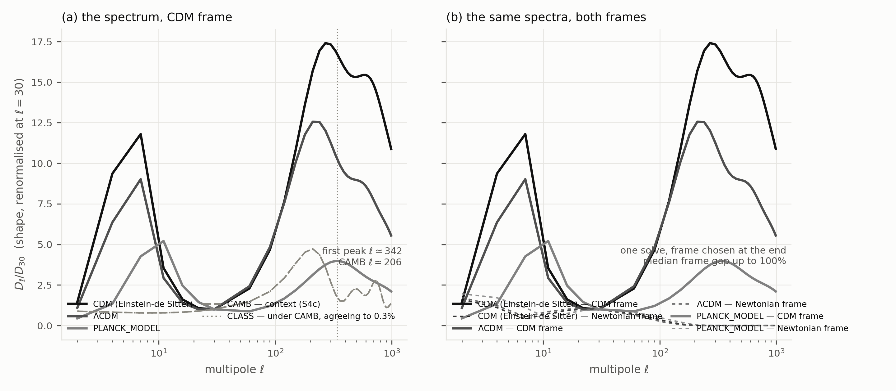
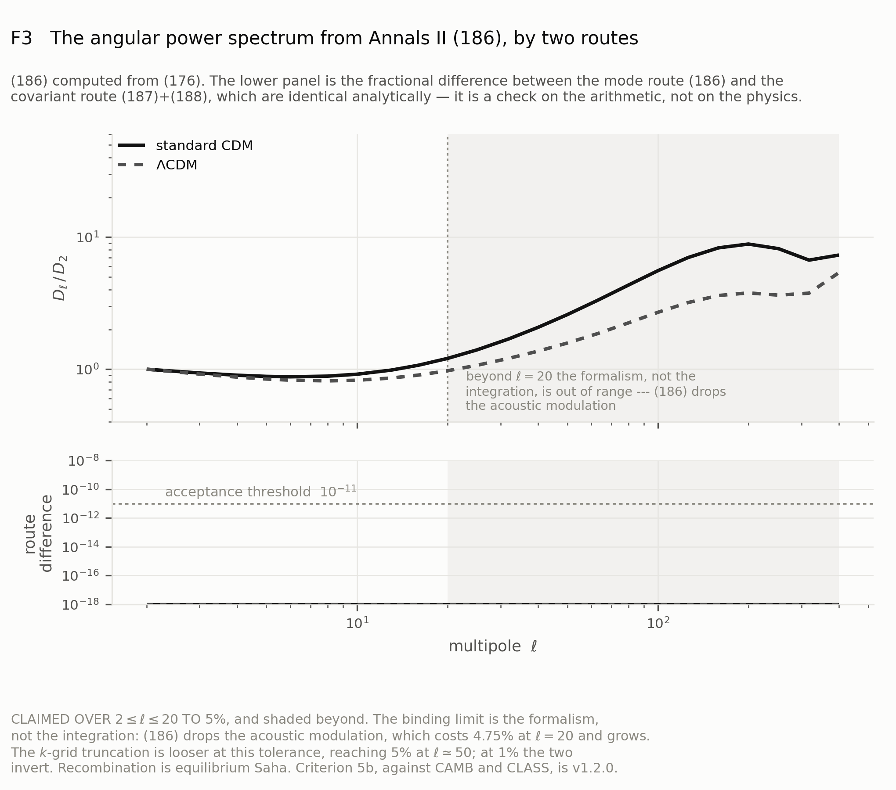
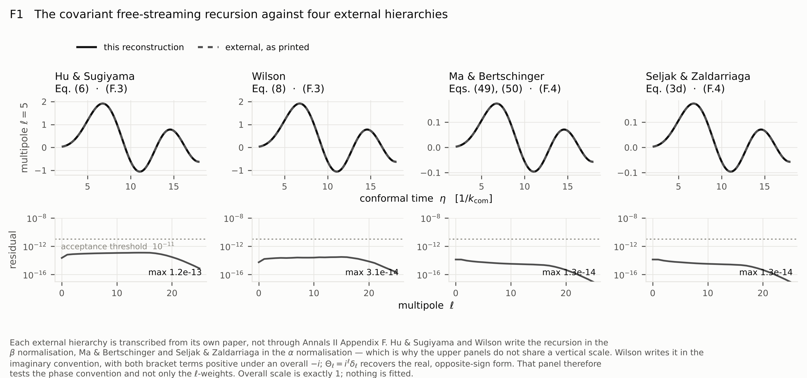

# 1+3 covariant CMB anisotropies reproducibility bundle

Version: **v1.3.0-dev** — the recombination grid derived from the visibility's
own width (**S33**), a structural audit of the code, the acoustic modes set
against *Annals II*'s own 1+3 acoustic equations with Hu & Sugiyama as the
analytic comparator (**S37**), and **the frame discrepancy localised to one
site** (**T-82**, **T-85**, **T-86**) with the term that dominates its
integrand measured (**T-94**). **Last release: v1.2.0** — tagged 2026-10-16:
the full linear spectrum with the acoustic peaks and the Silk damping tail
(F9), in both frames; the integral solution (102) carried with a generic
4-velocity and specialised back; acceptance criterion 5b closed.

Supplement: **v1.3.19** — `SUPPLEMENTARY-MATERIAL-v1.3.19.tex`. **This is a
separate version line from the one above and is declared separately on
purpose.** The line above is the *computational* release; a supplement edition
records a documentation gate and is **not** an assertion that the repository
physics release has advanced. `scripts/_versions.py` reads the supplement's
name from *this* line, never from the computational one, because the two were
coupled only while they happened to agree.

Supplementary code and materials for: Tim Gebbie, *"Frame covariance of CMBR
lensing in the exact $1+3$ covariant radiation hierarchy"* (**Paper 1**),
University of Cape Town, 2026, **arXiv:astro-ph/9912072v4**
([doi:10.48550/arXiv.astro-ph/9912072](https://doi.org/10.48550/arXiv.astro-ph/9912072)), submitted 2026-10-16, CC BY 4.0.

> **Cite it versioned.** A bare `astro-ph/9912072` resolves to whatever is
> current, and that identifier has carried **three distinct documents**:
> **v1/v2** (Dec 1999) the legacy 1999 work, **v3** (3 Oct 2026) **the
> correction** that withdrew the 1999 claim of a new effect, and **v4**
> (21 Oct 2026) **Paper 1**. So **`v4` for Paper 1, `v3` for the correction,
> `v2` for the legacy work** — an unversioned reference to any of them now
> points at Paper 1 instead.

The supplementary-materials document is included here:

> [SUPPLEMENTARY-MATERIAL-v1.3.19.pdf](supplementary-materials/SUPPLEMENTARY-MATERIAL-v1.3.19.pdf)

Its source is `SUPPLEMENTARY-MATERIAL-v1.3.19.tex`, **one consolidated file in
the repository root**, which builds with `pdflatex` alone: the prose carries no
`\input`, the bibliography is inline, and the only external files are the
generated assets in `tables/`, `tikz/` and `figures/`. The prose fragments that
`scripts/build_supplement.py` used to assemble are gone, and that script needs
retargeting at the consolidated source.
It carries the scope, the theory-to-computation map, the acceptance spine, the
conventions and translations tables, and the interpretive limits — read it
before the code if you want to know what this release does and does not claim.

## Key figure: when the spectrum is laid down


**Figure F10** — **the fraction of today's $C_\ell$ already in place at conformal
time $\eta$**, for $\ell = 2, 5, 10, 30, 100, 200$. Columns are the three
backgrounds; rows are the two frames; the axis is
$(\eta-\eta_\ast)/(\eta_0-\eta_\ast)$ on a logarithm, because the visibility is
narrow and a linear axis spends almost all of itself on the free-streaming era.
Sixteen slices, accumulated inside the released quadrature in one pass — the
$\eta_0$ column reproduces the released spectrum to $1.2\times10^{-12}$, which is
the figure's gate and what makes the rest of it evidence. Generated by
`scripts/figure_f10_formation_surface.py`; diagnostic **D30**; finding **T-128**.

> **What this figure establishes.** Every other instrument in this bundle
> measures a *finished* spectrum. This one shows it being built, and **the
> plateau's defect is visible here and nowhere else.**
>
> * **Every curve reaches 1 within 1% of the conformal span and is flat
>   afterwards.** The spectrum is complete at recombination, on all three
>   backgrounds and in both frames. The late share — everything deposited after
>   the visibility closes — reads **0.0000** in all thirty-six curves.
> * **On $\Lambda\mathrm{CDM}$ and the Planck set that is wrong by construction.** The
>   late integrated Sachs–Wolfe effect must put $O(0.1)$ of $C_2$ there. It puts
>   none.
> * **On Einstein–de Sitter it is right by construction**, because $\Phi$ is
>   exactly constant (Appendix G) and there is no late ISW to have. **That null
>   control is what makes the first two readings a defect rather than a
>   numerical artefact**: if something other than the weight were wrong, the EdS
>   column would not come out exactly zero.
>
> **The mechanism is B-17 discrepancy (i).** (102) carries the bulk bracket at
> $\mathcal V\mathcal D$ where the exact by-parts wants $W$; $\mathcal
> V = W\kappa'$ is sharply peaked at $\eta_\ast$ and is zero afterwards, so every
> late-time source is multiplied by zero. **The late ISW is not missing from the
> formalism — it is present at rank one and annihilated by the weight.**
> `provenance/ANNALS-II-ANTECEDENT-AND-CORRECTIONS-v1.md` carries B-17 and its
> four discrepancies; no repair has been adopted into the released path.
>
> **Why a figure and not a gate.** $\ell_{\rm peak}$ and the median contributing
> $k$ are scalar summaries of the endpoint, and three pre-registered predictions
> were scored against them before this was drawn. **The missing plateau power is
> a defect in time**, so no summary of the endpoint can see it. **F10 does not
> supersede F9**: F9 says *where* the power lands in $\ell$, F10 says *when* it
> was laid down, and those are different failures with different causes.

## The angular spectrum with the acoustic peaks



**Figure F9** — **linear-log $D_\ell/D_{30}$**, shape renormalised at $\ell=30$, for CDM, ΛCDM and the Planck 2018 set, against CAMB and CLASS as context. **(a)** the three backgrounds in the **CDM frame**; **(b)** the same spectra in both frames. **Re-run 2026-10-21 after the scattering-rate units correction (T-109).** First peaks **224.2 / 193.7 / 266.6** against CAMB **206.1** and CLASS **206.2** — PLANCK's excess fell from $+65.8$ to $+29.4$. **The morphology is the thing to read**, and it splits three ways: the plateau is **absent** (a spurious maximum at $\ell=7$ where CAMB has none), the **secondary peaks are absent** (CAMB has two, at 480 and 720), and the primary peak is 29% high. Findings **T-109**, **T-111**. Generated by `scripts/figure_f9_acoustic_spectrum.py`.

> **What this figure does and does not yet show, as of 2026-10-21.** It is the
> bundle's deliverable and it is **not yet a correct spectrum**, and the
> caption says so rather than letting the picture imply otherwise.
>
> * **Acoustic structure is present** and the oscillation is created correctly:
>   (δT+Φ_A)(η\*) tracks cos(k r_s) in exact phase and period, and the solver's
>   effective sound horizon matches the tabulated one to 2% (**T-71**, **T-74**).
> * **Peak positions are wrong, and there are two separate statements of it.**
>   *(i)* The **first peak of $D_\ell$** sits at ℓ ≃ 342 on the Planck set
>   against **206** in CAMB and CLASS run at this bundle's own N_eff = 0 — the
>   number annotated on the figure. *(ii)* The **oscillatory residual** has
>   maxima near 176 and 476 where **this bundle's own synthetic control** —
>   a cos(k r_s) fed through its own projection kernel, EdS, 𝒱 weight,
>   transfer function off — puts them at 196 and 544, a ≃12% compression that
>   is **not** r_s, **not** r_θ and **not** the projection kernel, all three
>   measured and excluded (**T-74**). *These are different quantities on
>   different objects and neither is the other's target.*
> * **There is no Sachs–Wolfe plateau.** Both weights put too much power at
>   ℓ=2 relative to 5 ≤ ℓ ≤ 30 (**T-73**).
> * **There is no late integrated Sachs–Wolfe term**, on either Λ background.
>   PLANCK's ℓ=2 exceeds EdS's by 12% under 𝒱 and ΛCDM's by 0.2%; a real late
>   ISW is a factor, not a few percent. The cause is **not** the weight —
>   the weight difference at low ℓ is the same factor of sixteen on
>   Einstein–de Sitter, which has no ISW to lose (**T-74**).
> * **Panel (b)'s two frames do not agree**, by order one at every multipole,
>   where the ℓ≥2 multipoles are frame-invariant *at first order* (point 3
>   above, and the qualifier is not decoration in a repository named for
>   nonlinear shear). **Localised,
>   2026-10-20.** The rank-1 *source* agrees between the columns to 10⁻¹⁵
>   before any projection (**T-82**); the by-parts identity holds in both
>   frames to quadrature (**T-85**); so the whole of the gap is downstream, in
>   the slot-and-weight assignment of C₁ (**T-86**). Five repair attempts have
>   failed and are recorded as failures (**T-88**–**T-93**); the derivation is
>   with P1-T.
>
> **And one term dominates the integrand (T-94).** In the Newtonian frame
> 93–97% of (102)'s integrand at k ≤ 60 is the single term 𝒱κ″v̂_B, which is
> **1.8×10⁵ times the physical Doppler source g·v̂_B** — three powers of κ′
> where the source carries one. The acoustic driving is 0.02% of it; the ISW
> on PLANCK is 0.18%. **It is weight-independent**, so A-2 cannot reach it: it
> exists because (102) integrates by parts *onto the coefficients*,
> differentiating a C₁ that still contains κ′. P1-T reached the same statement
> from the integrating factor — *by parts on the product, never on the
> coefficient*.
>
> The figure is published in this state deliberately. Five repair attempts have
> been made and withdrawn; `provenance/BUNDLE-DEFECTS-v1.md` carries each with
> the control that withdrew it, and every number above.

**This is the release where the spectrum stops being the almost-Friedmann–
Lemaître analytic skeleton.** **Panel (a)** is the deliverable: shape, $D_\ell$
renormalised at $\ell=30$, for the three backgrounds this bundle ships — CDM (Einstein–de Sitter), ΛCDM, and the
stamped Planck 2018 set with a derived photon-only radiation era. The peaks and
the damping tail come from *Annals II*'s own equations: the integral
solution (102) with the Bond–Efstathiou transfer function driving the
oscillation per mode, and the diffusion scale from **(dif-damp-correct)** at
$f_2=3/4$ — the antecedent's own corrected coefficient, not a departure from it
(**T-43**).

**CAMB and CLASS are drawn dashed, and they are context rather than a target**
(**S4c**). Criterion 5b is gated on this bundle's own pipeline, (102) against
(177)–(179), which agree to $9.5\times10^{-6}$ against a gate of $10^{-3}$.
The distance to the external codes is large, expected, and **itemised rather
than totalled**: 97.8% across the plateau, 137% across the peaks, of which the
damping coefficient alone is 17.2%, the rest attributable to the
slow-decoupling order and the visibility weight (102) carries. The first peak
sits at $\ell\simeq170$ here against 198 in both codes, consistent with
$z_\ast=1114.5$ against 1088.5. The itemisation is in
`provenance/CRITERION-5B-v1.md`; the derivations are in the supplement.

**Panel (b) draws the same spectra in both frames, and it is the panel a
gauge-fixed treatment cannot produce.** Both come from *one* solve: (102) is
carried with a generic $u^a$ and the frame is chosen at the end, so the
Newtonian and CDM curves are two projections of the same coefficients rather
than two calculations. **This shows that** the frame is a choice made at the
end of the derivation and not an assumption built into its start — which is the
claim the $1+3$ covariant approach exists to make, drawn here rather than
asserted.

## The physics, end to end

This bundle computes the CMB angular power spectrum from the **exact $1+3$
covariant radiation hierarchy** — not from a gauge-fixed perturbation theory
with a covariant gloss. The chain below is the whole of it, and every step
names the module that implements it.

### Notation

Every symbol used in the chain below is defined here, once, so no equation on
this page needs another file to be read. Equation numbers in tags are
*Annals II*'s published ones; the full conventions sheet is
`provenance/conventions.md`.

**$k$ is comoving throughout this README.** Appendix F's recursions and the
integral solution (102) are written in the comoving wavenumber, so
$k_{\rm phys}=k/a$. `functions/harmonics/free_streaming.py` carries the warning
that a bare $k$ is ambiguous between the two and that they differ by a factor
$a$ in precisely these equations.

**Two derivatives appear, and step 1 uses both.** An overdot is the derivative
along the fundamental congruence, $u^a\nabla_a$; a prime is
$\mathrm d/\mathrm d\eta$, with $\eta$ conformal time.

| symbol | meaning |
|---|---|
| $u^a$, $e^a$ | the fundamental 4-velocity; a unit direction on the sky, so $T(x,e)$ is the temperature seen looking along $e^a$ |
| $\eta$, $\eta_0$, $\eta_\ast$ | conformal time; today; last scattering. $\Delta\eta\equiv\eta_0-\eta$ and $\Delta\eta_\ast\equiv\eta_0-\eta_\ast$ |
| $a$, $\mathcal H$ | scale factor; conformal Hubble rate $a'/a$ |
| $k$, $r_s$ | comoving wavenumber; comoving sound horizon at last scattering |
| $\mathrm D_a$ | spatial derivative, projected orthogonal to $u^a$ |
| $\langle\thinspace \cdots\thinspace \rangle$ | the projected, symmetric, trace-free (PSTF) part of the enclosed indices |
| $A_\ell$ | the **multi-index** $a_1\ldots a_\ell$ |
| $A_a$ | the **acceleration** $\dot u_a$ — a different object from $A_\ell$, sharing a letter |
| $\tau_{A_\ell}$, $\tau_\ell$ | PSTF temperature multipoles; the mode coefficient of the same |
| $T$, $\delta T$ | the temperature, *defined* as the monopole of $T(x,e)$; its perturbation |
| $T_\ell(k)$ | the **transfer function** — carries a multipole index, and is not the temperature |
| $O^{A_\ell}$, $\beta_\ell=\ell!/(2\ell-1)!!$ | the PSTF direction tensor; its normalisation $O^{A_\ell}O_{A_\ell}$. $\beta_0=\beta_1=1$, $\beta_2=\tfrac23$ |
| $\alpha_\ell=(2\ell+1)/\beta_\ell$ | the normalisation in which (F.4) takes the Ma & Bertschinger form. $\alpha_0=1$, $\alpha_1=3$, $\alpha_2=\tfrac{15}2$ |
| $\mathcal B_{A_\ell}$, $\mathcal S_{A_\ell}$ | the gravitational source; the in-scattered Thomson source |
| $\sigma_{ab}$, $\sigma_T$ | the shear; the Thomson cross-section — again one letter, two objects |
| $\kappa'=an_e\sigma_T$ | differential optical depth, with $n_e$ the free-electron density |
| $W=e^{-\kappa}$, $\mathcal V=W\kappa'$ | the optical-depth weight; the visibility function |
| $\mathcal D$, $k_D$ | the diffusion (Silk) damping factor $e^{-(k/k_D)^2}$ and its scale. $\mathcal D$ is **not** $\mathrm D_a$ |
| $\Phi_A$, $\Phi_H$ | the two gauge-invariant potentials, acceleration and curvature |
| $\rho_b$, $\rho_\gamma$, $R=3\rho_b/4\rho_\gamma$ | baryon and photon energy densities; the baryon loading |
| $\hat v_B$, $q_a$ | the baryon velocity; the energy flux, which the CDM frame sets to zero |
| $v^a$, $v_{A_\ell}$ | the frame tilt $\tilde u^a-u^a$; its PSTF part of rank $\ell$, identically zero for $\ell\ge2$ |
| $c_\pm$ | coefficients of $\tau_{\ell\pm1}$ in the $O(\ell)$ aberration coupling. Subscripts $\mathrm N$ and $\mathrm{CDM}$ label the two frames throughout |
| $f_\ell$ | the multipole profile the $O(\ell)$ stencil differentiates, as $\ell\thinspace \partial_\ell f_\ell$ |
| $C_0,C_1,C_2$; $p_0,p_1,p_2$ | the matching coefficients of (89); their exact rational prefactors |
| $j_\ell$, $P(k)$, $C_\ell$ | spherical Bessel function; primordial power; the angular power spectrum |

**Rendering note.** In display equations this file writes `\eta_\ast`, never
the asterisk form: GitHub runs markdown's emphasis parser before the maths
renderer, and a literal asterisk opens emphasis intraword. Finding **T-120**.
For the same reason **no prose on this page may contain a doubled dollar
sign**, even inside backticks — the renderer counts it as a delimiter, pairs
it with the next real one, and every display after it inverts with the prose
around it. The `.tex` sources are unaffected and keep the asterisk form.

**1 — The hierarchy.** The photon distribution is expanded in
projected, symmetric, trace-free (PSTF) temperature multipoles
$\tau_{A_\ell}=\tau_{a_1\ldots a_\ell}$ about a chosen 4-velocity $u^a$. The
exact transport equation is

$$\dot\tau_{A_\ell}+\tfrac{\ell+1}{2\ell+3}\mathrm D^a\tau_{A_\ell a}-\mathrm D_{\langle a_\ell}\tau_{A_{\ell-1}\rangle}+\kappa'\tau_{A_\ell}=a\mathcal B_{A_\ell}+\kappa'\mathcal S_{A_\ell}\quad(68)$$

with $\kappa'=an_e\sigma_T$ the differential optical depth.
`functions/spectra/` carries it; `tests/` holds the Appendix F chain against
four external hierarchies.

**2 — The source closes at rank two.** The gravitational source
$\mathcal B_{A_\ell}$ is **identically zero for $\ell\ge3$**:

$$\mathcal B_0=-\tfrac13\mathrm D^a\tau_a,\qquad \mathcal B_a=\mathrm D_a\ln T+A_a,\qquad \mathcal B_{ab}=\sigma_{ab}\quad(71)$$

— a monopole from the dipole divergence, a gradient-plus-acceleration at rank
one, and **the shear at rank two**. That the chain terminates is what makes a
closed-form integral solution possible at all, and the shear entry is why this
repository is called `NonlinearShear`. `functions/spectra/coefficients.py`.

**3 — The frame law, and what is invariant.** Under a change of fundamental
congruence $\tilde u^a=u^a+v^a$, GDE99 (37) gives

$$\tilde\tau_{A_\ell}=\tau_{A_\ell}-v_{A_\ell}, \qquad v_{A_\ell}\equiv0\ \ (\ell\ge2)\quad(GDE99 37)$$

— only the monopole and dipole move. Every $\ell\ge2$ multipole is a frame
invariant **at first order**, and not because a boost cannot reach it: those
multipoles are already first-order small, so what a boost would generate from
them is second order. Only $\tau_0$ is $O(1)$, which is why the dipole moves
and nothing above it does. The bundle computes the spectrum **twice** — once
with $\tilde\sigma_{ab}\simeq0$ (Newtonian) and once in the CDM frame — and the
two must agree. A disagreement is therefore a defect and not physics, which is
what **F5** and **D6** measure. `functions/spectra/frame_transform.py`,
`functions/frames.py`.

**The same $v^a$ acts a second way, and that one does not die at $\ell=2$.**
The frame law above moves the *moments* against a fixed direction basis; the
boost also moves the *basis*, which is aberration. Aberration couples
neighbouring multipoles with coefficients that grow like $\ell$, and the
difference of the two neighbour weights differs between the frames:

$$c_+-c_-|_{\mathrm N}=\frac{2(2\ell^2+2\ell-1)}{(2\ell-1)(2\ell+3)}\xrightarrow{\ \ell\to\infty\ }1, \qquad c_+-c_-|_{\mathrm{CDM}}=\frac{3(4\ell^4+8\ell^3-11\ell^2-15\ell+6)}{(2\ell-3)(2\ell-1)(2\ell+3)(2\ell+5)}\xrightarrow{\ \ell\to\infty\ }\tfrac34\quad(Paper 1)$$

Both stencils are unit-normalised, $2\times\tfrac12=1$ and $4\times\tfrac14=1$,
so the two frames thread different coefficients onto the same
$\ell\thinspace \partial_\ell f_\ell$. That is frame covariance holding at $O(\ell)$,
where the moment law has nothing left to say — and the surviving $O(\ell)$
content is **gravitational lensing together with observer aberration**, which
is the result Paper 1 is named for. The coefficients are the brackets Paper 1 prints after the $\beta$
normalisation. *This is not the claim that lensing is a frame effect.*
It is narrower and better: one $v^a$ acts on the moments and on the direction
basis, and only the second action survives at large $\ell$.

**4 — Decoupling and the acoustic oscillator.** Before last scattering the
photons and baryons are tightly coupled and the rank-0 and rank-1 multipoles
obey the acoustic pair (152)/(153),

$$\tau_1'=-\frac{R'}{1+R}\tau_1-\frac{k}{1+R}\delta T-k\Phi_A, \qquad \delta T'=-\mathcal H\Phi_A-\Phi_H'+\tfrac k3\tau_1\quad(152, 153)$$

with $R=3\rho_b/4\rho_\gamma$ the baryon loading — the oscillator whose
$\cos(kr_s)$ is the acoustic peaks. Dropping the $-\mathcal H\Phi_A$ is
*Annals II*'s own small-scale approximation and is exactly what turns the pair
into (154); the bundle integrates the pair, not the approximation. The
recombination history is solved from Peebles' equation and the grid is
**derived from the visibility's own width**. `functions/spectra/acoustic.py`,
`decoupling.py`, `peebles.py`.

**5 — Free streaming, and where every $\ell\ge3$ comes from.** After decoupling
$\kappa'\to0$, and by step 2 the gravitational source is identically zero for
$\ell\ge3$. What is left of step 1 is a pure recursion coupling each multipole
to its two neighbours — *Annals II* Appendix F (F.3), in conformal time:

$$-(\beta_\ell\tau_\ell)' =k\left[\frac{\ell+1}{2\ell+3}\thinspace (\beta_{\ell+1}\tau_{\ell+1}) -\frac{\ell}{2\ell-1}\thinspace (\beta_{\ell-1}\tau_{\ell-1})\right]\quad(F.3)$$

**This ladder is the whole of the high-multipole spectrum.** The source supplies
$\ell=0,1,2$ and nothing else; every multipole above that is streamed up from
them by this equation. Its closed-form solution is $j_\ell(k(\eta_0-\eta))$,
which is *why* the kernel in step 6 is a spherical Bessel function rather than
a fitted window — the projection is not an approximation imposed on the
hierarchy, it is the hierarchy's own solution. Appendix F writes the recursion
three ways — (F.1) in proper time with the comoving wavenumber, (F.3) above,
and (F.4) in the normalisation that makes it the Ma & Bertschinger form. The
bundle integrates all three **as printed** and privileges none, which is the
acceptance spine of v1.0.0 and what **F1** reports: four external hierarchies,
two normalisations, two phase conventions, residuals $\lesssim10^{-13}$. (F.4)
as printed keeps $(2\ell+1)$ on the left although its own preceding text
specifies the division — finding **B-2**; the bundle divides.
`functions/harmonics/free_streaming.py`, `weights.py`, `external.py`.

**6 — Matching, and the integral solution.** At decoupling the free-streaming
solution of step 5 is matched to the source rank by rank, (89), giving three
coefficients:

$$C_0=p_0\thinspace (a\mathcal B_2),\qquad C_1=p_1\thinspace \tfrac1k\negthinspace \left(a\mathcal B_1+\kappa'\hat v_B\right),\qquad C_2=p_2\thinspace \tfrac1{k^2}(a\mathcal B_2)\quad(89)$$

(89) is the definition and (90) a result, so the bundle solves (89) in exact
rationals and uses (90) as a check on itself. Solved that way (90)'s $C_0$
comes out with the opposite sign to the printed one — finding **B-11**,
traceable to $j_0''(0)=-\tfrac13$ from the ascending series, printed as
$+\tfrac13$. The coefficients are CGI with respect to a generic $u^a$, so a
frame choice sets them: Newtonian is $\tilde\sigma_{ab}\approx0$, hence
$\tilde C_0\approx\tilde C_2\approx0$ and $\tilde C_1$ alone; CDM is $q_a=0$
and keeps all three. The line-of-sight integral (102) carries them to the
present:

$$\frac{\beta_\ell\thinspace \tau_\ell(\eta_0)}{2\ell+1}\simeq[C_2'-C_1]_{\eta_\ast}\mathcal D\thinspace j_\ell(k\Delta\eta_\ast)+kC_2(\eta_\ast)\mathcal D\left[\tfrac{\ell}{2\ell+1}j_{\ell-1}-\tfrac{\ell+1}{2\ell+1}j_{\ell+1}\right]_{k\Delta\eta_\ast}+\int_{\eta_\ast}^{\eta_0}\mathrm d\eta\thinspace \mathcal V e^{-(k/k_D)^2}\lbrace C_0-C_1'+C_2''\rbrace \thinspace j_\ell(k\Delta\eta)\quad(102)$$

The second term has never been evaluated in a released figure: it is the
rank-two boundary, and $\tilde C_2\equiv0$ in the Newtonian frame. It is also
the only place in the scheme where the *projection* couples $\ell$ to
$\ell\pm1$ — a different coupling from step 5's, acting at the boundary rather
than along the path. `functions/spectra/coefficients.py`,
`integral_solution.py`.

**7 — The spectrum, and the two routes.** The observable is assembled from
three factors and nothing else: the primordial power $P(k)$, the transfer
$T_\ell(k)$ that (102) returns, and the projection $j_\ell$ already inside it.
*Annals II* §7.2 writes the assembly twice —

$$C_\ell=\frac2\pi\frac{\beta_\ell^2}{(2\ell+1)^2}\int\frac{\mathrm dk}{k}\thinspace k^3\thinspace  |\tau_\ell(k,\eta_0)|^2\quad(186)$$

$$\langle\tau_{A_\ell}\tau^{A_\ell}\rangle =\frac{\beta_\ell}{2\pi^2}\int k^2\mathrm dk\thinspace |\tau_\ell|^2, \qquad C_\ell=\frac{\Delta_\ell}{2\ell+1}\langle\tau_{A_\ell}\tau^{A_\ell}\rangle, \quad \Delta_\ell=\frac{4\pi\beta_\ell}{2\ell+1}\quad(187, 188)$$

— (186) by the mode route and (187)–(188) by the covariant route. They were
proved identical before either was implemented, and the bundle computes both
so the release reports a number rather than a claim: they agree to
$9.5\times10^{-6}$ against a gate of $10^{-3}$, which is acceptance criterion
5b. **The $\ell$-dependent normalisation cancels exactly.** With
$T_\ell\equiv\beta_\ell\tau_\ell(\eta_0)/(2\ell+1)=\alpha_\ell^{-1}\tau_\ell$,
which is what (176) returns, (186) collapses to

$$C_\ell=\frac2\pi\int \mathrm dk\thinspace k^2\thinspace |T_\ell(k)|^2\quad(186 with 176)$$

because $\alpha_\ell=(2\ell+1)/\beta_\ell$ makes the prefactor exactly one —
asserted as exact rationals, not floating point. That is worth more than
tidiness: a $\beta_\ell$ or $\alpha_\ell$ slip cannot hide in the spectrum,
because it would have to survive an identity. And the variable in which it
vanishes is precisely the one step 5's solution is bare in. **The covariant
route is the one that generalises**: (186) is a statement about mode
coefficients and holds only for almost-Robertson–Walker geometries, (187) is a
multipole mean square and holds generally, which is why every released figure
plots the multipole quantity. `functions/spectra/angular.py`, `two_route.py`,
`pipeline.py`.

### Where the implementation stands

**Working, and checked.** The hierarchy against four external treatments; both
routes to (186) agreeing at $9.5\times10^{-6}$ against a $10^{-3}$ tolerance;
the Sachs–Wolfe scalar **in the coefficients**, $(\delta T+\Phi_A)-C_2'=\Phi_A/3$
to 0.68% on EdS (**D21**); the covariant→mode→covariant round trip, identically
zero in exact arithmetic; the recombination history and the acoustic
oscillator, whose $(\delta T+\Phi_A)(\eta_\ast)$ tracks $\cos(kr_s)$ in exact
phase and period.

**Not yet right, and this is the live work — and as of 2026-10-21 it splits
three ways rather than two.** Counted from F9's own CSV against CAMB:

| | CAMB | this bundle |
|---|---|---|
| low $\ell$ | **no maximum** — a flat plateau | **a spurious maximum at $\ell=7$**, 8.8–13.9× the value at $\ell=30$ |
| primary peak | 210 | 224 / 194 / **267** — PLANCK 29% high, down from 66% |
| secondary peaks | **480 and 720** | **none** |

**The plateau and the missing secondary peaks are one defect, and it is not
the one the peak position is.** At low $k$ the boundary term is 105%
$\kappa'\hat v_B$, which puts a Doppler-shaped term where Sachs–Wolfe belongs;
in the bulk $\mathcal V\kappa''\hat v_B$ is 93–97% of the integrand and is
*smooth*, so it swamps the oscillation — which **exists in the source**, where
$(\delta T+\Phi_A)(\eta_\ast)$ tracks $\cos(kr_s)$ in exact phase and period —
and buries the secondary peaks. One term, two symptoms, and the $W$-form
(**S48**) is the repair for both; the two frames disagreeing is the third
symptom of the same term.

**Measured at the limit where it is decidable, 2026-10-22 — finding T-117.**
The transfer $T_\ell(k)$ does **not** reduce to the Sachs–Wolfe transfer
$(\Phi_A(\eta_\ast)/3)\mathcal D j_\ell$ as $k\to0$. The limit *exists* and is
$\ell$-independent across $\ell=2\ldots20$ to 0.6%, so no wrong $j_\ell$,
$\alpha_\ell$ or $\beta_\ell$ can be responsible. On EdS it is
$+9.4\times10^3$ in the Newtonian frame — of which the boundary is $-25.7$ and
the bulk $+9.46\times10^3$, both of them $\kappa'\hat v_B$ and its derivative
— and $-1.10$ in the CDM frame, whose **boundary tends to $-0.9999$: the
Sachs–Wolfe transfer with the sign reversed, to one part in $10^4$.** Flipping
that one sign alone would put the CDM limit at $+0.896$. Whether it *is* a
sign defect is not yet established and **B-11** is the obvious suspect; what is
established is that the failure lives in what the matching carries into (102)
and nowhere else. `scripts/diagnostic_d23_superhorizon_transfer.py`.

**The peak position is a different thing and it is already scheduled.** The
peak now sits at $1.00\thinspace \ell_A$ where the standard is $0.757\thinspace \ell_A$ — the
matched CAMB's own ratio — and $1/0.757$ accounts for the residual 29% to
within 2%. That is the **acoustic phase shift**, which radiation-era driving
supplies: approximation **A-3**, and **v1.4.0's**.

**That bare $\kappa'$ is now measured rather than inferred.** Every coefficient
this bundle builds is affine in $\kappa'$, so scaling $\kappa'$ in the
*coefficient construction alone* splits each one exactly into its
$\kappa'$-free and $\kappa'$-carrying parts — verified affine to $10^{-16}$.
**$C_1$ and $C_1'$ carry it and $C_0$, $C_2$, $C_2''$ do not**, and the share
is $\simeq1$: the $\kappa'$ part is not a correction to $C_1$, it is
essentially the whole of it. **The Thomson in-scattering has been folded into
the matching coefficients rather than left under the visibility**, and once it
is inside $C_1$ every later operation acts on a quantity carrying a scattering
rate it should never have had — in the bulk through the by-parts, and at the
boundary, where $C_1(\eta_\ast)$ enters under the diffusion factor with no $W$ and
no $\mathcal V$ at all. Finding **T-101**, diagnostic **D18**.

> The measured record of every defect, including five repair attempts that
> failed and were withdrawn, is `provenance/BUNDLE-DEFECTS-v1.md`. **It is
> deliberately not summarised here**: this README is for the physics and the
> implementation, and the register is where the working record lives.

### The release sequence, and what v1.5.0 needs from v1.3.0

The arc is one physical question asked at increasing order. **Each release is
a term put back into the calculation**, and each is the precondition for the
next — which is why the version numbers track the physics rather than the
calendar.

| | the physical question | the term it puts back, and where | evidence |
|---|---|---|---|
| **v1.0.0** | *Is the reconstruction faithful?* Free streaming alone — the $\ell$-coupling of step 1 with the source switched off | the recursion itself: `recursion.py`, `angular.py`, `two_route.py`. Four external hierarchies in two normalisations and two phase conventions; (186) by both routes; the Sachs–Wolfe limit | **F1**, **F3**, **F4** · released |
| **v1.1.0** | *What does the spectrum need that it does not have?* **A visibility of finite width** — an instantaneous last scattering has no damping tail | Peebles' effective three-level atom replaces equilibrium Saha and becomes the default (**S22**): `peebles.py`, `decoupling.py`. The visibility peak moves $z\simeq1300\to1107$ and widens by $\sim40$%, and **that width is what sets the Silk envelope** | **F6** · released |
| **v1.2.0** | *Is the antecedent's own algebra self-consistent when evaluated?* **The full linear source**, and (102) carried with a **generic** $u^a$ and specialised back | the complete rank-0/1/2 assembly: `coefficients.py`, `integral_solution.py`, `frame_transform.py`. Criterion 5b closes at $9.5\times10^{-6}$ against $10^{-3}$ | **F9**, **F5**, **F7**, **D8** · released |
| **v1.3.0** | *Does that assembly produce the right spectrum?* **The acoustic oscillator**, driven on a derived recombination grid (**S33**) and set against *Annals II*'s own (152)/(153) with Hu & Sugiyama as the analytic comparator | `acoustic.py`, and the slot-and-weight structure of $C_1$ inside (102). The oscillator tracks $\cos(kr_s)$ in exact phase and period; **the projection of it does not yet land the peaks** | **D9**–**D17** · **current** |
| **v1.4.0** | *What is missing from the envelope?* **Radiation-era driving** (**A-3**) and the **tight-coupling transition** — slip and a growing quadrupole (**A-5**) | `peebles.py`, `acoustic.py`: $\Phi$ allowed to decay across equality, $k_D$ evaluated at the baryon loading the oscillator actually runs at, $\Omega_r$ restored to `LCDM_MODEL` — worth 37% in $\ell_A$ | **D10** · planned |
| **v1.5.0** | *What happens at second order in the shear?* The $\mathcal O(\varepsilon^2\ell)$ couplings §5.5 discards, **kept rather than dropped** | $\tfrac25\mathrm D^c\tau_{ac}$ restored to the dipole equation; $\sigma_{ab}$ enters the oscillator instead of being dropped at $\mathcal O(t_c\varepsilon)$ | **D3** · planned |

**v1.5.0 is why the repository is called `NonlinearShear`, and it is why
v1.3.0 has to be right first.** §5.5 of the antecedent drops the shear
coupling from the oscillator at $\mathcal O(t_c\varepsilon)$ on the grounds
that $\sigma_{ab}$ is first order; v1.5.0 is the release that stops assuming
it. The term it puts back, $\tfrac25\mathrm D^c\tau_{ac}$, enters **the same
rank-1 slot** whose weight and by-parts structure v1.3.0 is currently
measuring — so v1.3.0 is not a detour before the interesting work, it is what
makes the interesting work interpretable.

**And the shear is already computed.** `cdm_frame_shear` returns $\sigma$,
$\dot\sigma$ and $\ddot\sigma$, and `tests/` holds Appendix G's $\dot\sigma$
against the Euler equation at $10^{-9}$. **The quantity v1.5.0 needs exists
and is verified; it simply does not yet enter the dynamics.**

## Second figure: the angular power spectrum by two routes



Eq. (186) computed from Eq. (176) by the **mode route** and the **covariant
route**, agreeing exactly because they are one calculation written twice. This
is the almost-Friedmann–Lemaître skeleton: no transfer function, no acoustic
modulation, claimed only over $2\le\ell\le20$ — a range **derived** rather than
chosen (`scripts/derive_ell_range.py`). Read beside F9 it is the progression in
one glance.

## Third figure: the Appendix F match



The covariant free-streaming recursion of *Annals II* Appendix F against **Hu &
Sugiyama** Eq. (6), **Wilson** Eq. (8), **Ma & Bertschinger** Eqs. (49)/(50) and
**Seljak & Zaldarriaga** Eq. (3d), each read from its own paper and integrated
as printed. Residuals of $10^{-13}$ to $10^{-14}$ against a $10^{-11}$
threshold, at overall scale exactly 1. Four independent checks in **two
normalisations and two phase conventions** — Wilson is written in the imaginary
convention and so tests the phase, not only the $\ell$-weights. This is the
bundle's strongest single piece of evidence and it has held unchanged across
all three releases.

The free-streaming recursion against each external treatment of (F.1)–(F.4), one
panel per treatment; four comparisons are four panels, not four colours on one
axis. Hu & Sugiyama write the recursion in the β normalisation, Ma & Bertschinger
and Seljak & Zaldarriaga in the α normalisation, which is why Appendix F prints
both (F.3) and (F.4). **Four panels from five sources**: Wilson & Silk (1981) is
the earliest and was read from its own page, but at $K=0$ it is Wilson (1983)
Eq. (8) exactly, so it is credited and not drawn — *Annals II*
names Wilson & Silk while keying Wilson.

## Legacy treatment from [Annals of Physics 282, 321 (2000)](https://doi.org/10.1006/aphy.2000.6034)

This bundle reconstructs its antecedent rather than porting it, and is built to
find that paper's remaining errors rather than to agree with it. These are the
findings that **change what the code computes**:

- **B-1** — *Annals I* prints (−1)^ℓ where its own definition gives i^ℓ.
  Inconsequential for the covariant multipole, which is invariant under the
  choice; the mode coefficients are not, and the two statements are distinct.
- **B-2** — (F.4) is algebraically correct but is not in the Ma & Bertschinger
  form the following sentence identifies it with: the (2ℓ+1)⁻¹ division its text
  specifies was not applied to the display.
- **B-3** — the Bessel identity (199) needs [(m/2)!]² in its denominator. It is
  exact where Γ(m/2+1) = 1, so (201) is unaffected; (204) is low by 11.4% and the
  D_ℓ of (205) correspondingly high by 12.8%.
- **B-5** — (201) omits one factor of the comoving distance in the reduction.
  This is the target of acceptance criterion 5a, so the criterion is stated
  against the corrected closed form rather than the printed one.
- **B-8** — (181) carries $+R_\ast\Phi_A$ where (180) gives $-R_\ast\Phi_A$. Both forms are
  implemented; the printed one is kept as a control.
- **B-10** — (J.5) prints the transfer function with +1/ν where the fit requires
  −1/ν. Both forms are implemented, for the same reason.

The complete record — fifteen findings, together with the antecedent's deliberate
approximations and the one lineage note — is in `provenance/`.

## Current situation: v1.3.0-dev

This bundle is an **independent Python reconstruction, from first 1+3 covariant
principles, of the almost-Friedmann–Lemaître results of** T. Gebbie,
P. K. S. Dunsby and G. F. R. Ellis, *1+3 covariant cosmic microwave background
anisotropies II: the almost-Friedmann–Lemaître model*, **Annals of Physics 282,
321–394 (2000)**, [doi:10.1006/aphy.2000.6034](https://doi.org/10.1006/aphy.2000.6034).

It is written bottom-up. It is not a port of, or a wrapper on, an existing
Boltzmann code, and it inherits no other code's conventions.

**Derived, not transcribed**, wherever the antecedent prints a result that can be
obtained instead. The FLRW background is integrated from the 1+3 energy
constraint, so Eqs. (185) and (G.3) are **checks on this bundle rather than
sources for it** — three of the fifteen recorded findings are disagreements between a
derived quantity and a printed one, and a port would have inherited all three
silently. The exceptions are stated where they occur: recombination rests on an
imported atomic-physics fit, and `functions/spectra/peebles.py` tabulates what is
derived there and what is not.

**What each release established, and the term it put back**, is the release-sequence table above; **S22** (Peebles over Saha) and **S33**
(the grid derived from the visibility's own width) are the two defaults it turns on.

### The artefacts, and the physics each one measures

Ten figures and twenty-nine diagnostics, each pointed at **one** physical
question. A figure's version is the release that last changed its *content*, so
F1, F3 and F4 still read `v1.0.0`. `tests/test_readme_artefacts.py` checks every
row against `figures/` and `scripts/run_all.py`.

| Figure | Evidence for | Version |
|---|---|---|
| **F1** Appendix F match | criterion 1 — the free-streaming chain against **four external hierarchies** in four conventions, two normalisations and two phase conventions, residuals $\lesssim10^{-13}$ | `v1.0.0` |
| **F2** truncation convergence, both frames | **Appendix E made quantitative.** Two quantities that do not shrink together: what a truncation *discards* falls off a cliff in $k$ at $\ell\simeq k\Delta\eta$; what it *destroys* — the shear, and with it ranks 0 and 2 — has **no $\ell_{\max}$ in it**, is **99.93% at $\ell=2$ and 100% by $\ell=600$** (it read 0.54–0.68% and 32% before **T-57**, when the line-of-sight weight was making the dipole the whole transfer; the CDM frame's source *is* the shear, as §VI C says, and removing it destroys the spectrum). Footnote 29 (p. 365) is checked and holds: the cost is **identically zero** in the Newtonian frame, which has no shear to lose. A third panel answers the question of whether the covariant sectors supply an **excess at low $\ell$**: they do not — their share is **0.54% at the quadrupole** and grows with $\ell$, and T-31 shows the frame cannot supply one either | `v1.2.0` |
| **F3** angular spectrum, both routes | criteria 3 and 4 — (186) by the mode route and the covariant route, agreeing **exactly** since T-17 put the combined coefficients in $\mathbb Q$ | `v1.0.0` |
| **F4** real-space correlation | the round trip $C_\ell\to C(\theta)\to C_\ell$, residual $<10^{-13}$ | `v1.0.0` |
| **F5** source decomposition, two frames | **the total is common to both frames and the decomposition is not**, split by rank (S28). The frame disagreement is its own panel and is now **total** — median $9.99\times10^{-1}$, worst $1.00$ over $2\le\ell\le400$, from 42%/7%/11% before **T-57**. That is finding **T-59** | `v1.2.0` |
| **F6** what each approximation is worth | A-1, A-2 and the small-scale approximation as **ratios**, over six decades — one is a different calculation, one is free where this release claims, one is worst at large scales | `v1.1.0` |
| **F7** frame specialisation | the generic $u^a$ carried through and the frame chosen at the end — a figure a gauge-fixed treatment cannot draw. **It reports that its own planned claim is false**: the dipole was expected to stand an order of magnitude apart and lands on each curve instead, worst ratio **1.24×**, because (102) builds every $\ell$ from the same three $C_A$ and has no mechanism for answering differently at different $\ell$ (T-31) | `v1.2.0` |
| **F8** coupling schematic | a structural statement, not a measurement: which couplings exist at which order | `v1.1.0` |
| **F9** angular spectrum with the acoustic peaks | **the release's deliverable** — $D_\ell$ for CDM, $\Lambda\mathrm{CDM}$ and the Planck set, shape-normalised at $\ell=30$, with the peaks and the damping tail, against CAMB and CLASS as context (**S4c**). The committed rendering is the **log–log $C_\ell/C_{30}$** one and the script now produces **linear-log $D_\ell/D_{30}$**: a re-run reconciles them, finding **T-99**. Which frame panel (a) draws is open as **S44** — **T-59** measured that the Newtonian frame carries the Sachs–Wolfe plateau and the CDM frame the acoustic rise, and neither carries both | `v1.2.0` |
| **F10** formation surface — when the spectrum is laid down | **the defect in time**, and the only artefact here in which the missing plateau power is visible. The fraction of the final $C_\ell$ in place at each conformal time, six multipoles, three backgrounds, both frames. Every curve is complete within 1% of the span past $\eta_\ast$ and the late share is **0.0000** everywhere, where $\Lambda\mathrm{CDM}$ and Planck require $O(0.1)$ at $\ell=2$ (the late ISW) and Einstein–de Sitter requires exactly zero. **The EdS null control is what makes it a defect rather than an artefact.** Mechanism: B-17 (i), the bracket carried at $\mathcal V\mathcal D$ where the by-parts wants $W$. Gated on the $\eta_0$ column reproducing the released quadrature, $1.2\times10^{-12}$. Finding **T-128** | `v1.3.0` |

| Diagnostic | Evidence for | Version |
|---|---|---|
| **D0** $\ell$ range, and B-3 | criterion 5's claimed range, derived rather than chosen: $2\le\ell\le20$ at 5% | `v1.0.0` |
| **D1** relative-sign control | criterion 4, and criterion 3 in executable form — the $c^2=-1$ branch **diverges**, which is what makes the correct one evidence | `v1.0.0` |
| **D2** round-trip residual | criterion 2's kinematic half, identically zero in exact arithmetic | `v1.0.0` |
| **D5** Sachs–Wolfe limit | criterion 5a at 5%, **and the statement that it cannot discriminate B-5** — the two forms differ by a factor with no $\ell$ dependence | `v1.0.0` |
| **D6** (102) in two frames | the frame-invariance measurement F5 rests on, with the residual split by sector | `v1.2.0` |
| **D7** CDM frame vs energy frame | **T-29** — *Annals II* §4.1 lists them as two of three distinct choices and this bundle conflates them; the tilt is up to 45% of the frame velocity | `v1.2.0` |
| **D8** criterion 5b's gate | (102) against (177)–(179) on this bundle's own pipeline, **S4c** — 9.544e-06 worst against 10⁻³, over three backgrounds, nine modes and six multipoles | `v1.2.0` |
| **D9** the acoustic scale | the antecedent's own ℓ_j = \|r_θ/r_s\| jπ, **both sides computable here and never compared** — it disagrees by 2.0–2.8×. Finding **T-51** | `v1.3.0` |
| **D4** the monopole, and which rank carries C_ℓ | the antecedent's *"there is no monopole temperature anisotropy in the CGI approach"*, made executable — and the instrument that found **T-57**: under the weight every released caller was silently taking, the rank-0 monopole sector is 0.002% of C_ℓ and the rank-1 dipole is 100.5% of it. Runs both weights every time | `v1.3.0` |
| **D10** what A-3 costs | the released driving freezes Φ below the recombination grid's first point while every mode starts far earlier (**T-51**), so the oscillator crosses the radiation era on a potential that does not decay. Reports which modes have a radiation era to see and how much Φ the frozen form omits — 0.13% at k=10 and 105% at k=600 — and **deliberately stops there**, because the acoustic grid carries 3 to 26 points below equality. Finding **T-64** | `v1.3.0` |
| **D11** the ℓ=0 driving terms | `d_delta = −Φ_H′ + (k/3)τ₁` and a𝓑₀ = −⅓kτ₁, so a𝓑₀ is a **source, on the right, once** — which settles which side the printed `modeibe` double-counts it on. Φ_H′ is machine zero on EdS and 59% of a𝓑₀ on PLANCK at k=10. Finding **T-79** | `v1.3.0` |
| **D12** v_B + σ at the source | CAMB's single `g(v_b+σ)` object, differenced between the two columns **before any projection** — no transfer, no j_ℓ, no weight, no validity gate. **9.3×10⁻¹⁶ to 1.8×10⁻¹³** at every k on both backgrounds, so the rank-1 source is frame-consistent and the gap is downstream. Finding **T-82** | `v1.3.0` |
| **D13** the by-parts 2×2 | the same transport source direct and through its fully integrated-by-parts form, identical endpoints, **both frames**. Both identities hold — the residual falls under refinement, so it is quadrature — and A_N ≠ A_C by 1.0–1.8 of scale. Boundary-against-bulk bookkeeping **excluded**. Finding **T-85** | `v1.3.0` |
| **D14** the slot repair lattice | the B-slot controls over their full lattice, which is **M11a as a method**: three of four score as failures alone. **Its result is withdrawn** — T-88's improvement was a spurious ×κ′ of 320–682 (**T-93**) — and the diagnostic is kept because a withdrawn number that cannot be regenerated cannot be checked | `v1.3.0` |
| **D16** the κ′² in the integrand | the six pieces of (102)'s Newtonian integrand, each against the others. **One term is 93–97% of it** at k ≤ 60 and is **1.8×10⁵ times the physical Doppler source**; the acoustic driving is 0.02% and the ISW 0.18%. **Weight-independent**, so A-2 cannot reach it. Finding **T-94** | `v1.3.0` |
| **D17** the W-form against (102) | P1-T's boxed integrating-factor form of the line-of-sight solution evaluated beside the released (102), in both frames. If the W-form is frame-invariant where (102) is not, the gap is in the assembly and the by-parts is where it enters; if **both** carry it, the assembly is not the site. **Reads $\mathcal O(1)$ in both columns and is held inconclusive**: the rank-0 row needs $\sigma_0$ and the CDM column needs $S_2$, both referred to P1-T | `v1.3.0` |
| **D18** the $\kappa'$ ledger on the released code | P1-T's rule — *$\kappa'$ may live in $W$, in $\mathcal V$, or in a derivative of either, **never in a coefficient*** — applied to the arrays this bundle actually builds. Every coefficient is **affine in $\kappa'$**, verified at $\lambda=2$ to $10^{-16}$, so the split into $\kappa'$-free and $\kappa'$-carrying parts is exact. **$C_1$ and $C_1'$ carry a bare $\kappa'$ and it is essentially the whole of them** (share 0.99–1.02; 0.51 at $k=300$ Newtonian); $C_0$, $C_2$, $C_2''$ are clean. Finding **T-101** | `v1.3.0` |
| **D19** the ℓ=0 row control, on the live coefficients | the acceptance measurement for the monopole-row correction. **All four of its conditions PASS and the repair is still wrong** (**T-107** refuted it on an external gate). That is **M14** as an instrument: a difference-based gate cannot see a defect common to both things differenced. Kept so that a withdrawn variant stays regenerable | `v1.3.0` |
| **D20** what the two $h$ defects in the scattering rate are worth | **T-108**'s measurement and **T-109**'s evidence, scored against $z_\ast=1088.5$ from the matched external codes — an **external** gate, which is what M14 requires after four difference-based conditions passed on a wrong repair. It is the correction that moved PLANCK's first-peak excess from $+65.8$ to $+29.4$ | `v1.3.0` |
| **D21** the Sachs–Wolfe scalar, on the live coefficients | Stage 4(a). `c1_identity.py` had checked this against fixtures since `v1.0.0` and it had never been pointed at the production path. It tests $\delta T$, $\Phi_A$ and $C_2'$ and **nothing else** — no $C_0$, no $C_1'$, no dipole. It **passes at 0.68% on Einstein–de Sitter**, which is what moved the search downstream of the source. Finding **T-113** | `v1.3.0` |
| **D22** the transport identity on live histories | Stage 3's gate, and the first instrument pointed at **transport** rather than at coefficients. The identity closes to $10^{-5}$ to $10^{-7}$ with a *consistent* derivative and fails at **0.4–65%** with the one (106)/(107) supplies — both right separately and **not usable together**. Finding **T-114**. `c3_byparts.py` cannot see this: on fixtures the derivative is consistent by construction | `v1.3.0` |
| **D23** Stage 4(b): the transfer against Sachs–Wolfe as $k\to0$ | the complete transfer against the SW transfer in the superhorizon limit. **The limit exists and is $\ell$-independent**, which excludes every projection defect at once — and it is $9.4\times10^{3}$ (Newtonian) and $-1.10$ (CDM) where it must be 1. The CDM boundary tends to $-0.9999$: **Sachs–Wolfe with the sign reversed**. The reference is built twice and the two agree to $3\times10^{-8}$, so nothing in the ratio is a convention. Finding **T-117** | `v1.3.0` |
| **D24** the Φ′ sweep: dead, drowned, or unfed | whether the acoustic driving channel is **dead, drowned or merely unfed** — three different repairs, which no single-number gate distinguishes. It scales $(\Phi_A'-\Phi_H')$ and nothing else, because scaling $C_1'$ whole conflates driving with Doppler (**M15** inside a coefficient), and it reports $\ell_{\rm peak}$, so **M16** is satisfied by construction. **Drowned**: $\kappa''\tilde v_B$ is **99.8%** of $\lvert C_1'\rvert$, and restoring the driving alone moves the peak *down*. Finding **T-121** | `v1.3.0` |
| **D25** the $k$-decomposition of the low-ℓ spectrum | where in $k$ each low-ℓ $C_\ell$ actually comes from — the step between a $k\to0$ result and an ℓ-space claim, which both streams had written as a caveat rather than measured. **The $k\le0.1$ window where T-117's limit holds supplies at most 0.64% of any $C_\ell$, so T-117 is not the plateau.** The *level* of the median contributing $k$ proves nothing — $j_\ell(kr_\theta)$ peaks at $kr_\theta\simeq\ell+0.8\ell^{1/3}$ with a long tail — and only its **shape** survives: monotone decay in ℓ, closed by $\ell=173$. Finding **T-122**, corrected by P1-T | `v1.3.0` |
| **D26** the bulk-source lattice, screened on G-b | the seven bulk-source controls over their lattice, screened on the **cheap** gate so the expensive one is spent only on survivors. It exists because `BULK_SOURCE_CONTROLS` made all seven reachable from the spectrum at all: before it, one combination was | `v1.3.0` |
| **D27** gate G-a: the peak position against $\ell_A$ | $\ell_{\rm peak}/\ell_A$ against the target **0.757** ($206/272.177$) — a spectrum-level quantity, which **M16** requires of any coefficient-level claim. **It scored a pre-registered prediction and the prediction failed**: $[0.55,0.80]$ predicted, **0.0073** measured. Registered so the failure stays reproducible rather than remembered | `v1.3.0` |
| **D28** the restoration crosses, at released $\kappa''$ | the configurations that survived D26, run at **released** $\kappa''$ rather than with the knob. Cross B is **the first first-peak this bundle has produced without a knob** — $0.8691$ in the CDM frame — and it is **also the row that refuses adoption**, because the Newtonian frame reads $0.2770$, a factor of **3.1** apart, and $\ell\ge2$ is frame-invariant at first order | `v1.3.0` |
| **D29** B-17's identity, at released $\kappa''$ | the identity itself, and **the first instrument to implement it**: `slot_weight_split` was taken for the control for discrepancy (i) by both streams and is a different claim — it splits $C_1'$ and leaves $\kappa''\tilde v_B$ where it was (**T-125**). Pre-registered before it ran. Checkpointed row-at-a-time after four long runs were lost to container restarts (**T-127**) | `v1.3.0` |
| **D30** when the spectrum is laid down | **F10's instrument, and the one that found T-128.** $C_\ell$ accumulated in conformal time inside the released quadrature, one pass. Two gates: the $\eta_0$ slice must equal the released integral it decomposes, and non-monotonicity is reported rather than assumed. **Late share 0.0000 on all three backgrounds**, where ΛCDM and Planck require $O(0.1)$ and Einstein–de Sitter requires exactly zero — **the EdS null control is the falsifier**. Finding **T-128** | `v1.3.0` |
| *D3* | *deferred to v1.5.0 (S-b)* — a cross-check, not an acceptance artefact. **Retargeted 2026-10-15, finding T-47**: it was deferred *to v1.1.0*, which shipped without it, so the harness announced a deferral to a release in the past. `run_all.py` now fails on a deferral to an already-released version. **D4 was here and was discharged 2026-10-17**: it had been deferred three times on the reasoning that its stated question was a one-line claim with little room for error, and it turned out to be the only instrument pointed at a different question entirely | — |

### Compute cost: what one spectrum takes

**Measured, not estimated** — `scripts/benchmark_single_run.py`, one angular
correlation function from all the physics at a fixed parameter set, excluding
the tests, the figures and the manifests. Those measure what it costs to
*check* the bundle, which is a different question from what it costs to *run*
it.

*Snapshot: CPython 3.13 on Linux x86_64, numpy 2.5, 2026-10-15; 39 multipoles
to $\ell=990$, 1433 modes to $k=1500$, `PLANCK_MODEL`. A benchmark is a
property of a machine, so this is dated and labelled rather than asserted;
re-run the script anywhere to replace it.*

| stage | seconds | share | why |
|---|---:|---:|---|
| background | 0.05 | 0.0% | adaptive quadrature per panel; independent of k and ℓ |
| recombination history | 0.31 | 0.1% | one stiff Radau solve, then the visibility and opacity |
| environment and transfer function | 0.44 | 0.1% | the η grid, the potentials, the Bond–Efstathiou shape |
| Bessel table | 6.85 | 1.5% | j_ℓ(x) tabulated **once** and reused by every mode |
| **per-mode loop** | **452.47** | **98.3%** | the acoustic solve and the line-of-sight projection, once per k |
| &nbsp;&nbsp;*of which* coefficients | *239.22* | *52.0%* | solving (152)/(153) and assembling C₀, C₁, C₂ |
| &nbsp;&nbsp;*of which* projection | *213.24* | *46.3%* | ∫dη against j_ℓ for every ℓ |
| primordial power | 0.00 | 0.0% | P(k) ~ k^(n_s−4), one array |
| k quadrature to C_ℓ | 0.01 | 0.0% | one integral per multipole against the stored transfer |
| C_ℓ → C(θ) | 0.01 | 0.0% | Legendre sum at 721 angles |
| **TOTAL** | **460.13** | **100%** | **316 ms per mode, over 1433 modes** |

**This shows that the cost is in one place, and that the place is not where a
reader would guess.** Recombination — the physics that took a release to get
right — is 0.1%. The deliverable the reader actually asked for, $C(\theta)$, is
0.01 seconds. **Everything is the per-mode loop**, split almost evenly between
solving the oscillator and projecting it along the line of sight, and it is
linear in the number of modes because each mode is independent.

**What it means for v1.5.0.** It is the measurement decision **S24** was argued
on, now broken down: $A_s$ and $n_s$ enter *only* the last two rows, which cost
$0.01$ s against the $452$ s above them. A sampler that re-runs the whole chain
per proposal pays four hundred times for something it could store — which is
why the v1.5.0 interface must expose $T_\ell(k)$ and its grid as a first-class
product rather than only $C_\ell(\theta)$. **This table is the argument, not an
illustration of it.**

**What it does not license.** Decision **S30** defers run-time optimisation to a
dedicated assessment for v2.0.0, and nothing here overrides that: the loop is
embarrassingly parallel and obviously so, and that is precisely why tuning it
now — before the handover this benchmark exists to measure against — would be
optimising ahead of the requirement.

## The contracts this release is bound by

**Summarised; the contracts themselves are in `provenance/`.** They exist so a
physical claim here can be traced to the equation it came from and the
measurement that checked it.

| | |
|---|---|
| **decisions** | `provenance/DECISIONS-v1.0.0.md` — S (scope), L (lineage), V (visual grammar), D (documents), R (reproducibility) |
| **what the antecedent gets wrong** | `provenance/ANNALS-II-ANTECEDENT-AND-CORRECTIONS-v1.md` — fifteen findings, each with the printed equation beside the corrected one |
| **what this bundle gets wrong** | `provenance/BUNDLE-DEFECTS-v1.md` |
| **the approximations, named** | `provenance/SOURCE-APPROXIMATIONS-v1.md` — A-1 to A-5, each with what it costs and where |
| **conventions and equation numbers** | `provenance/conventions.md`; `provenance/EQUATION-NUMBERS-ANNALS-II-v1.md` maps every label to its **published** number |

**The ones that constrain the physics, in one line each.**

- **S1** — the deliverable is the CDM and $\Lambda\mathrm{CDM}$ angular power spectra in
  the almost-Friedmann–Lemaître formulation: (186) from (176), **by both the
  mode route (187)/(188) and the covariant route**. Two routes, because one
  route cannot check itself.
- **S15** — *an approximation of the source is not a finding against it.* The
  antecedent's deliberate narrow choices are **reproduced faithfully** and
  recorded as A-1…A-5; only defects are corrected. Departing from an
  approximation is allowed where the source is not the target, and is named at
  the call site and in the caption.
- **S26** — the audit half is in scope: relations *Annals II* needs and never
  wrote — the generic $\dot{\mathcal B}_A$, and the expansion–potential
  relation that checks them — are **derived here** rather than deferred.
- **S27** — every artefact carries a maturity rung, and a release gates on the
  rung rather than on an opinion that the work is done.
- **S43** — *a default that encodes an approximation must be named at every call
  site*, enforced by the release gate, because an unstated weight is an
  unstated approximation.
- **T-23** — *a derivative comes from a published relation, never from a spline
  through a stored amplitude*, because mode-expanding a derivative is not
  differentiating a mode amplitude.

**S19** fixes the release order — Paper 1 submitted, then public, then each
release public as it lands — which is why this repository is public now and
why v1.5.0 is not on the critical path for it.

## Future situation: the route to the full spectrum

**Planned, and not claimed by this release.** v1.4.0 and v1.5.0 are the next
two terms in the release-sequence table above — the envelope, then second
order in the shear. Beyond them:

| | what it adds, physically |
|---|---|
| **v2.0.0** | the **almost-EGS bounds**: how nearly isotropic the radiation has to be for the almost-Friedmann–Lemaître conclusion to hold, which is the theorem this whole line of work rests on and the one quantity the bundle has never bounded. `provenance/ALMOST-EGS-BOUNDS-v1.md` is a table skeleton with no derived bound in it yet |
| | **possibly a second language.** The per-mode loop is **98.3% of one spectrum** and is embarrassingly parallel, so a compiled implementation is a design question about that loop and nothing else — `CovariantCMBR.jl` is the candidate, and it would be a port of a reconstruction that is already right rather than a second reconstruction |

**The scheduling rule is physical, not procedural**: an envelope term is not
touched while the source assembly it sits under is being measured, because
moving the envelope moves the number the measurement is reading. **A
second-order correction added to a linear assembly that is not yet right is
not a correction — it is two unknowns.** That is why v1.4.0 and v1.5.0 follow
v1.3.0 rather than running beside it.

## Scientific boundary

This is an analytical reproducibility bundle for the associated paper and its
supplement. It is not an empirical calibration, not a parameter-estimation
pipeline, and not a Boltzmann code for general use.

**No new effect is claimed here, and none is reported.** The exact 1+3 covariant
radiation multipole hierarchy contains couplings between the shear and the
temperature multipoles whose coefficient grows linearly in ℓ. Their O(ε²ℓ)
content is **gravitational lensing together with observer aberration**, with no
residue. Nothing here is a detection claim.

Two statements must travel together, and neither stands alone: the nonlinear
contribution δτ_NL **matters** — it is not negligible and not an artefact — and
it **adds nothing**, redistributing power rather than creating it, because
δτ_NL ∝ ΦΦ makes its contribution to C_ℓ quartic in Φ while the linear C_ℓ is
quadratic.

The bundle reproduces; it does not argue. Any physics claim belongs to the paper,
and no claim appears here that is not in the paper.

## Repository structure

```text
config/                  Accepted scientific and release configurations
functions/background/    The FLRW background, integrated from the 1+3 constraint
functions/frames.py      The frame shift, symbolically, with orders tracked
functions/harmonics/     PSTF weights, the recursion, and the external hierarchies
functions/spectra/       Sources, recombination, the acoustic pair, the spectrum
functions/plotting/      House visual style, shared by every figure
scripts/                 Active reproduction and verification commands
tests/                   Compact claim-bearing regression suite
tests/frame/             Frame instruments, importing nothing else here
data/                    No empirical data are required at v1.0.0
outputs/                 Machine-readable curve and summary evidence
figures/                 Versioned PDF/PNG figure pairs
tables/                  Generated audit tables: equations, parameters, notation
captions/                Standalone captions, and the figure plan for the set
diagnostics/             Generated scientific acceptance checks
source/source-v1/        Frozen target-paper source
source/source-v2/        Computational conformity and clarification inserts
provenance/              Theory-to-code traceability and the corrections record
supplementary-materials/ Compiled computational supplement
```

Two suffix conventions operate here, and they are different rules rather than
one rule applied loosely.

**Figures and tables carry the release they were *introduced* in**, not the one
that last regenerated them: F6 and F8 carry `-v1.1.0` while the figures
specified at v1.0.0 keep theirs, and `tables/equations-v1.0.0.tex` keeps its
suffix through every regeneration. **The supplement carries the release it
*belongs to*** — decision **S36**, **amended at v1.3.14 to conform to the
house exemplar** (`github.com/timgebbie/correlation-emergence-reproducibility`).
Each *release* freezes its own `SUPPLEMENTARY-MATERIAL-vX.Y.Z.tex` in the root
and the previous ones are kept beside it, exactly as one
`RELEASE-NOTES-vX.Y.Z.md` is kept per release; a development revision between
releases **replaces** its predecessor rather than accumulating beside it, which
is why `SUPPLEMENTARY-MATERIAL-v1.3.0.tex` left the tree when v1.3.14 entered
it and `SUPPLEMENTARY-MATERIAL-v1.2.0.tex` did not. Its *build output* is not
kept: there is **one**
`supplementary-materials/SUPPLEMENTARY-MATERIAL-vX.Y.Z.pdf` in the tree at any
time, named for the source the build is pointed at, because the rendering of
record for an earlier release is its release asset and its archived DOI.
**The document is a single file from v1.3.14**, so there is no
`figures-vX.Y.Z.tex` and no fragment set: the figure pages are inline, and
`scripts/make_figure_pages.py` and `scripts/build_supplement.py` both need
retargeting at the consolidated source. `scripts/check_release_hygiene.py` is the
gate; finding **T-50** is what happens without it. Public tags and their
release assets remain unchanged in every case.

## Installation

```bash
python -m venv .venv && . .venv/bin/activate     # Windows: .venv\Scripts\Activate.ps1
pip install -r requirements.txt
```

Python 3.13 is the verified interpreter. PowerShell 5.1 has no `&&`; use `;`.

## Reproducing the active outputs

```bash
python scripts/run_all.py --strict     # regenerate everything, fail on any drift
python scripts/run_all.py --rerun      # regenerate without the drift gate
```

`--strict` is the release route: it regenerates every output, figure and table,
recomputes the manifests, and fails if any artefact differs from the recorded
hash. `--rerun` is the development route.

```bash
python scripts/make_tables.py          # regenerate the audit tables
python scripts/make_figure_pages.py    # regenerate the supplement's figure section
python scripts/make_manifests.py       # regenerate the two SHA256 manifests
python scripts/sync_conventions.py     # regenerate provenance/conventions.md
pytest -q                              # the claim-bearing regression suite
```

The frame instruments are a second suite and run on their own:

```bash
python tests/frame/run_all.py          # every frame instrument, in order
python tests/frame/doctor.py           # why the suite will or will not run
```

`tests/frame/run_all.py` and `scripts/run_all.py` share a name and do
different things: the first runs the frame instruments and writes
`docs/THEORY-AUDIT.md`, the second regenerates the bundle's artefacts. Run
both from the repository root, where the path says which one you meant.

## Verification status

**Released as v1.2.0; this tree is v1.3.0-dev.** Every artefact carries a
maturity rung and a release gates on the rung, not on an opinion that the work
is done (**S27**); `provenance/RELEASE-STATUS-v1.md` carries them and is
**generated and verified** — a claim whose module, object, test or harness
entry is missing fails the run.

| what is checked | where |
|---|---|
| the physics, against four external hierarchies and two independent routes | `pytest -q`; `tests/` |
| the frame conditions, from instruments whose independence is checked rather than asserted | `python tests/frame/run_all.py`; `docs/THEORY-AUDIT.md` |
| acceptance criteria, with criterion 5b itemised | `RELEASE-NOTES-v1.0.0.md`; `provenance/CRITERION-5B-v1.md` |
| every discretisation in the tree, by walking the AST | `provenance/GRID-REGISTER-v1.md` |
| the measured defects, including repairs attempted and withdrawn | `provenance/BUNDLE-DEFECTS-v1.md` |

The frame instruments import no project code, and since v1.3.18 that is a
property the suite enforces rather than a claim this file makes.
`tests/frame/_common.py` refuses any `sys.path` entry resolving to a bundle
directory outside `tests/frame`, and any imported module whose file lies
under the bundle outside it. It names violations by path rather than by
module name, exits 2 without emitting a result line, and every record
carries `independent` and `isolated_interpreter`.
`FRAME_ALLOW_PROJECT_IMPORTS` opens the gate for a deliberate experiment and
the record then says so: an escape hatch is allowed, a silent one is not.
`python tests/frame/doctor.py` reports why the suite will or will not run on
a given interpreter, using the standard library alone.

How many instruments there are is in `tests/frame/README.md` and not here.
That file reads its registry as a glob over the directory, so it cannot
disagree with what the directory holds; a count repeated in this file could,
and did.

**A green harness is not a correct spectrum.** `run_all.py --strict` reporting
`CLEAN` says every registered artefact regenerated, nothing more — finding
**T-54** is the run that printed `CLEAN` over a two-day-old figure.

This file does not assert where the released tag sits; the repository is the
only thing that knows, so it carries the check rather than the answer
(finding **T-30**):

```
git tag --list v1.2.0                                  # does it exist
git log --oneline -1 v1.2.0                            # where does it point
git merge-base --is-ancestor v1.2.0 HEAD; echo $?      # 0 if it is behind the tip
```

Two reading notes on the manifests. **`PORTABLE-MANIFEST-SHA256.txt` is what
binds** — it excludes the renderings and canonicalises numerics to nine
significant figures, and a mismatch there is release-blocking; the nine PNGs
that always report as drifted carry a 5 770-byte `caBX` chunk inserted by the
desktop bridge, not by anything here, and the `.pdf` of each round-trips
byte-exact (**T-15**, **T-36**). **AI assistance** is disclosed in
`provenance/AI-PROVENANCE-v1.md`.

## Version-control policy

Semantic versioning. **`CITATION.cff` states the released version and this
README's header states the tree version**, so a reader is never told a tree is
a release. Both are stamped by `scripts/_versions.py`, which is the one module
that says what version this tree is.

**A released tag is never moved** (**S39**), and a patch release is not cut for
inert content. The full history is in `CHANGELOG.md`; the decisions behind it
are in `provenance/DECISIONS-v1.0.0.md`.

## DOI, citation and license

| Item | Value |
|---|---|
| **Associated paper** | Gebbie, Tim (2026). *Frame covariance of CMBR lensing in the exact 1+3 covariant radiation hierarchy* — **Paper 1**, University of Cape Town. **arXiv:astro-ph/9912072v4**, [doi:10.48550/arXiv.astro-ph/9912072](https://doi.org/10.48550/arXiv.astro-ph/9912072). Submitted 2026-10-16. CC BY 4.0. **The version suffix is not optional** — the bare identifier has carried three documents: `v2` the legacy 1999 work, `v3` the correction, `v4` this paper |
| **Supplementary PDF** | [SUPPLEMENTARY-MATERIAL-v1.3.19.pdf](supplementary-materials/SUPPLEMENTARY-MATERIAL-v1.3.19.pdf) |
| **GitHub repository** | [timgebbie/frame-covariant-cmb-reproducibility](https://github.com/timgebbie/frame-covariant-cmb-reproducibility) |
| **ZivaHub/Figshare DOI** | [10.25375/uct.34069509](https://doi.org/10.25375/uct.34069509) — **live**. The **concept** DOI: it always resolves to the latest version, so it is the one to cite |
| **Associated antecedent** | Gebbie, T.; Dunsby, P. K. S.; Ellis, G. F. R. (2000). *1+3 covariant cosmic microwave background anisotropies II: the almost-Friedmann–Lemaître model*. Annals of Physics **282**, 321–394. [doi:10.1006/aphy.2000.6034](https://doi.org/10.1006/aphy.2000.6034) |
| **Code license** | MIT, see [`LICENSE`](LICENSE) |
| **Supplement, text, figures and tables** | CC BY 4.0, see [`CONTENT-LICENSE.md`](CONTENT-LICENSE.md) |

Citation metadata is in [`CITATION.cff`](CITATION.cff). Its `version` field
tracks the tag that exists, not the one in preparation: GitHub's *Cite this
repository* reads it, and a version there that has not been released asserts
a release nobody can fetch.
